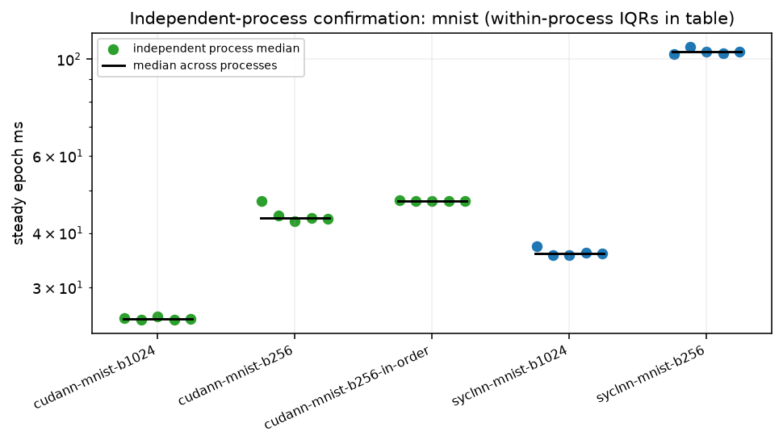
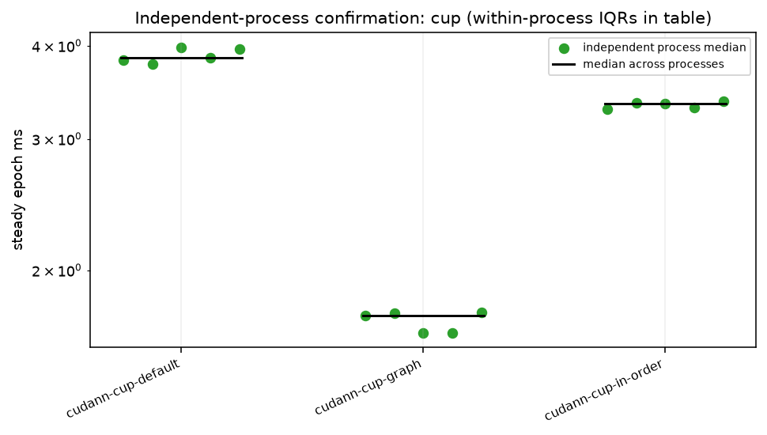

# Independent-process statistical confirmation

5 rounds, alternating CUDA/DPC++ order for each MNIST batch; CUP option order reverses in the even rounds. Each entry is one fresh `fnnbench run` process. Exact commands and original protocol source rows are in round-*/<configuration>/command.json. Epochs/repeats follow the pass: MNIST 3/3; CUP default 5/5, in-order and graph 5/3. Different conditions stay in separate rows.

Per-process median = median of steady_epochs_s (first epoch of every call excluded). Across-process spread is (max−min)/median. Within-process steady IQR is reported separately; these epochs are not independent process replicates.

| configuration | processes | medians ms | median ms | min–max ms | spread | within-process steady IQR ms | epochs / repeats |
|---|---|---|---|---|---|---|---|
| cudann-cup-default | 5 | 3.8236, 3.7821, 3.9841, 3.8573, 3.9599 | 3.8573 | 3.7821–3.9841 | 5.2% | 0.0218, 0.0224, 0.0135, 0.0105, 0.0194 | 5 / 5 |
| cudann-cup-graph | 5 | 1.7380, 1.7536, 1.6491, 1.6492, 1.7560 | 1.7380 | 1.6491–1.7560 | 6.2% | 0.0077, 0.0048, 0.0070, 0.0033, 0.0065 | 5 / 3 |
| cudann-cup-in-order | 5 | 3.2913, 3.3565, 3.3423, 3.3062, 3.3733 | 3.3423 | 3.2913–3.3733 | 2.5% | 0.0247, 0.0150, 0.0241, 0.0210, 0.0286 | 5 / 3 |
| cudann-mnist-b1024 | 5 | 25.5535, 25.3192, 25.8162, 25.3859, 25.4776 | 25.4776 | 25.3192–25.8162 | 2.0% | 1.4802, 0.1046, 0.2282, 4.5420, 0.3598 | 3 / 3 |
| cudann-mnist-b256 | 5 | 47.2880, 43.9450, 42.5324, 43.2327, 43.1502 | 43.2327 | 42.5324–47.2880 | 11.0% | 2.2225, 0.0765, 0.1087, 0.0861, 0.0768 | 3 / 3 |
| cudann-mnist-b256-in-order | 5 | 47.5691, 47.4335, 47.4290, 47.4528, 47.4528 | 47.4528 | 47.4290–47.5691 | 0.3% | 8.9445, 0.0669, 0.0348, 10.9725, 0.0350 | 3 / 3 |
| syclnn-mnist-b1024 | 5 | 37.3333, 35.6364, 35.6830, 36.0310, 35.9927 | 35.9927 | 35.6364–37.3333 | 4.7% | 1.2944, 0.0377, 3.2292, 2.4082, 3.5611 | 3 / 3 |
| syclnn-mnist-b256 | 5 | 102.9402, 106.6245, 104.2404, 103.3445, 104.0248 | 104.0248 | 102.9402–106.6245 | 3.5% | 0.1553, 0.0131, 0.2351, 0.0863, 0.2310 | 3 / 3 |

Remaining independent processes: {}

versions.txt:

```text
Python 3.12.3
Name: fnnbench
Version: 1.0.0
Summary: Benchmark harness for syclnn / cudann / ompnn: run, sweep, collect, replay, peak
Home-page: 
Author: 
Author-email: Antonio Napolitano <anton@polit.no>
License-Expression: LGPL-3.0-only
Location: /home/a.napolitano11/fnn/fnn-bench/pylib
Requires: fnn-testkit, numpy
Required-by: 
---
Name: fnn-testkit
Version: 1.0.0
Summary: NumPy reference implementation and shared parity test-suite for syclnn / cudann / ompnn
Home-page: 
Author: 
Author-email: Antonio Napolitano <anton@polit.no>
License-Expression: LGPL-3.0-only
Location: /home/a.napolitano11/fnn/fnn-bench/pylib
Requires: numpy, pytest
Required-by: fnnbench
---
Name: numpy
Version: 2.5.2
Summary: Fundamental package for array computing in Python
Home-page: https://numpy.org
Author: Travis E. Oliphant et al.
Author-email: 
License-Expression: BSD-3-Clause AND 0BSD AND MIT AND Zlib AND CC0-1.0
Location: /opt/venv/lib/python3.12/site-packages
Requires: 
Required-by: fnn-testkit, fnnbench

```

NUMA-POLICY:

```text
# NUMA policy for hpc-a30 rows, decided 2026-11-03 from results/hpc-a30/numa-pilot-2026-11-03
# (two ABAB rounds; scripts/numa-pilot-compare.py)
cpu: numactl --interleave=all
gpu: none
# gpu: none = default policy, process unbound, as in the 2026-09-17 pass. Binding the process and its
# memory to the A30's node (4) changed no GPU row beyond the round-to-round noise (cudann mnist-512-256
# b256 -4.5 % against 4.5 % noise; the other rows within 1 %). Use no numactl prefix for GPU jobs.

```

## Conditions and limits

Conditions snapshot not available; do not interpret missing conditions as controlled.

commands.txt:

```text
SLURM job 722680 on node09, partition gpu-excl
NUMA prefix: none (adopted default)
rounds: 5

```

versions.txt:

```text
Python 3.12.3
Name: fnnbench
Version: 1.0.0
Summary: Benchmark harness for syclnn / cudann / ompnn: run, sweep, collect, replay, peak
Home-page: 
Author: 
Author-email: Antonio Napolitano <anton@polit.no>
License-Expression: LGPL-3.0-only
Location: /home/a.napolitano11/fnn/fnn-bench/pylib
Requires: fnn-testkit, numpy
Required-by: 
---
Name: fnn-testkit
Version: 1.0.0
Summary: NumPy reference implementation and shared parity test-suite for syclnn / cudann / ompnn
Home-page: 
Author: 
Author-email: Antonio Napolitano <anton@polit.no>
License-Expression: LGPL-3.0-only
Location: /home/a.napolitano11/fnn/fnn-bench/pylib
Requires: numpy, pytest
Required-by: fnnbench
---
Name: numpy
Version: 2.5.2
Summary: Fundamental package for array computing in Python
Home-page: https://numpy.org
Author: Travis E. Oliphant et al.
Author-email: 
License-Expression: BSD-3-Clause AND 0BSD AND MIT AND Zlib AND CC0-1.0
Location: /opt/venv/lib/python3.12/site-packages
Requires: 
Required-by: fnn-testkit, fnnbench

```




