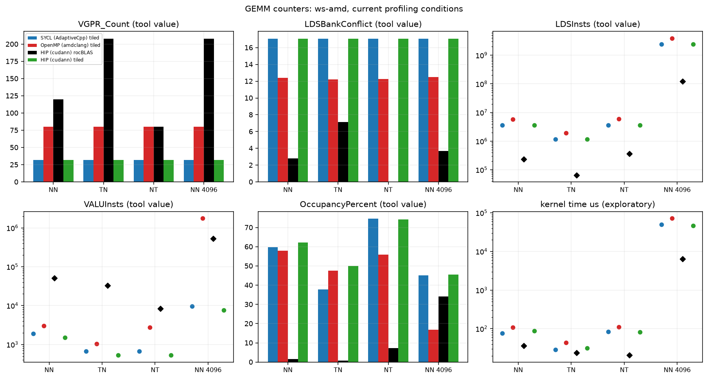
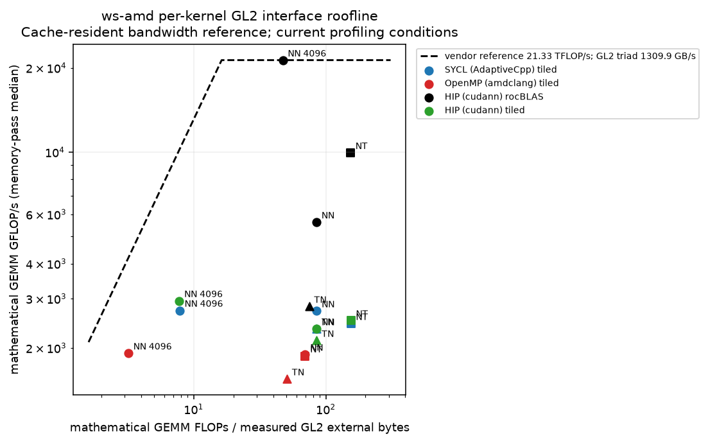

# RX 7900 XTX GEMM counters

Existing cudann HIP, AdaptiveCpp and amdclang wheels, float, blas=tiled; cudann/rocBLAS comparison. MNIST one batch of 256 and a large W4 batch after warm-up. Commands/builds are in each command.json and driver.json. Counter names were selected from this device's saved rocprofv3 --list-avail output. Each counter group is a separate process. The global ROCTx pause/resume and named range exclude setup/warm-up.

Shape labels follow the source submission order only when eight main GEMMs are observed. A changed vendor decomposition remains unlabelled. HIP/SYCL tiled grid sizes also check the association. Registers come from kernel metadata; LDS uses the JSON dispatch allocation, including dynamic local memory. The CSV LDS_Block_Size alone is static and reads zero for AdaptiveCpp even when its launch allocates local memory. Read/write traffic requires separate deterministic repeats because the combined counter request exceeds hardware slots. The roofline uses their summed traffic and median kernel duration; both original durations remain in kernels.json. FLOPs are the mathematical 2MNK count, not an instruction counter. FETCH_SIZE/WRITE_SIZE are converted only when counter-units.json records verified units and provenance. Counter boundary is described there.

| model | BLAS | shape (op M N K) | VGPRs | LDS bytes | LDS conflicts % | SQ LDS instructions | VALUInsts | occupancy % | waves | GL2 external bytes | time us | FLOP/byte | GFLOP/s |
|---|---|---|---|---|---|---|---|---|---|---|---|---|---|
| adaptivecpp | tiled | NN 4096 4096 4096 | 32 | 2048 | 17.07 | 2.416e+09 | 9546 | 45 | 5.243e+05 | 1.757e+10 | 5.048e+04 | 7.821 | 2723 |
| adaptivecpp | tiled | NN 512 256 784 | 32 | 2048 | 17.07 | 3.613e+06 | 1887 | 59.78 | 4096 | 2.409e+06 | 75.84 | 85.33 | 2710 |
| adaptivecpp | tiled | TN 512 256 256 | 32 | 2048 | 17.07 | 1.18e+06 | 666 | 37.75 | 4096 | 7.866e+05 | 28.64 | 85.32 | 2343 |
| adaptivecpp | tiled | NT 512 784 256 | 32 | 2048 | 17.07 | 3.613e+06 | 666 | 74.54 | 1.254e+04 | 1.327e+06 | 84.18 | 154.8 | 2441 |
| amdclang | tiled | NN 4096 4096 4096 | 80 | 3816 | 12.49 | 3.898e+09 | 1.752e+06 | 16.8 | 4608 | 4.29e+10 | 7.176e+04 | 3.204 | 1915 |
| amdclang | tiled | NN 512 256 784 | 80 | 3816 | 12.4 | 5.874e+06 | 3022 | 57.95 | 4096 | 2.942e+06 | 108.3 | 69.86 | 1897 |
| amdclang | tiled | TN 512 256 256 | 80 | 3816 | 12.21 | 1.954e+06 | 1042 | 47.57 | 4096 | 1.32e+06 | 43.32 | 50.84 | 1549 |
| amdclang | tiled | NT 512 784 256 | 80 | 3816 | 12.25 | 5.965e+06 | 2757 | 55.88 | 4608 | 2.942e+06 | 109.9 | 69.86 | 1871 |
| hipcc | auto | NN 4096 4096 4096 | 208 | 1.638e+04 | 3.704 | 1.216e+08 | 5.265e+05 | 34.15 | 4096 | 2.907e+09 | 6448 | 47.28 | 2.132e+04 |
| hipcc | auto | NN 512 256 784 | 120 | 1.434e+04 | 2.778 | 2.383e+05 | 5.068e+04 | 1.525 | 64 | 2.416e+06 | 36.52 | 85.08 | 5627 |
| hipcc | auto | TN 512 256 256 | 208 | 1.638e+04 | 7.143 | 6.554e+04 | 3.306e+04 | 0.7329 | 32 | 8.965e+05 | 23.86 | 74.86 | 2813 |
| hipcc | auto | NT 512 784 256 | 80 | 7168 | 0 | 3.594e+05 | 8364 | 7.354 | 416 | 1.337e+06 | 20.64 | 153.7 | 9957 |
| hipcc | tiled | NN 4096 4096 4096 | 32 | 2048 | 17.07 | 2.416e+09 | 7730 | 45.45 | 5.243e+05 | 1.766e+10 | 4.663e+04 | 7.783 | 2948 |
| hipcc | tiled | NN 512 256 784 | 32 | 2048 | 17.07 | 3.613e+06 | 1520 | 62.17 | 4096 | 2.409e+06 | 87.9 | 85.33 | 2338 |
| hipcc | tiled | TN 512 256 256 | 32 | 2048 | 17.07 | 1.18e+06 | 530 | 50.05 | 4096 | 7.866e+05 | 31.58 | 85.31 | 2125 |
| hipcc | tiled | NT 512 784 256 | 32 | 2048 | 17.07 | 3.613e+06 | 530 | 74.19 | 1.254e+04 | 1.327e+06 | 82 | 154.8 | 2506 |

Launch geometry for the requested kernels (OpenMP teams may iterate over multiple output tiles):

| model | BLAS | shape | workgroups | threads/group | static LDS B | dispatch LDS B |
|---|---|---|---|---|---|---|
| adaptivecpp | tiled | NN 4096 4096 4096 | 6.554e+04 | 256 | 0 | 2048 |
| adaptivecpp | tiled | NN 512 256 784 | 512 | 256 | 0 | 2048 |
| adaptivecpp | tiled | TN 512 256 256 | 512 | 256 | 0 | 2048 |
| adaptivecpp | tiled | NT 512 784 256 | 1568 | 256 | 0 | 2048 |
| amdclang | tiled | NN 4096 4096 4096 | 576 | 256 | 4096 | 3816 |
| amdclang | tiled | NN 512 256 784 | 512 | 256 | 4096 | 3816 |
| amdclang | tiled | TN 512 256 256 | 512 | 256 | 4096 | 3816 |
| amdclang | tiled | NT 512 784 256 | 576 | 256 | 4096 | 3816 |
| hipcc | auto | NN 4096 4096 4096 | 1024 | 128 | 1.638e+04 | 1.638e+04 |
| hipcc | auto | NN 512 256 784 | 16 | 128 | 1.434e+04 | 1.434e+04 |
| hipcc | auto | TN 512 256 256 | 8 | 128 | 1.638e+04 | 1.638e+04 |
| hipcc | auto | NT 512 784 256 | 208 | 64 | 7168 | 7168 |
| hipcc | tiled | NN 4096 4096 4096 | 6.554e+04 | 256 | 2048 | 2048 |
| hipcc | tiled | NN 512 256 784 | 512 | 256 | 2048 | 2048 |
| hipcc | tiled | TN 512 256 256 | 512 | 256 | 2048 | 2048 |
| hipcc | tiled | NT 512 784 256 | 1568 | 256 | 2048 | 2048 |

The main table selects the four requested shapes; all 64 main-GEMM records and their passes are in kernels.json. VALU utilisation/busy is not exposed on this gfx1100 setup. VALUInsts is the tool's average instruction count per work-item, not a utilisation percentage. All raw counters are retained in kernels.json and the CSVs. Do not infer occupancy from a waves count alone. Kernel-7.3 timing regressions and background display activity limit timing interpretation; use this experiment primarily to compare counter patterns.

OpenMP captures set OMP_TOOL=disabled to avoid an OMPT initialisation re-entry from OpenBLAS; hardware dispatch tracing/counting remains enabled. The compiled kernel and library are unchanged.

Memory counter definitions/units:

```json
{
  "FETCH_SIZE": "KiB",
  "WRITE_SIZE": "KiB",
  "boundary": "GL2 external request bytes. Radeon has Infinity Cache beyond L2; these values are not treated as DRAM-only bytes.",
  "FETCH_SIZE_expression": "(GL2C_EA_RDREQ_32B_sum*32+GL2C_EA_RDREQ_64B_sum*64+GL2C_EA_RDREQ_96B_sum*96+GL2C_EA_RDREQ_128B_sum*128)/1024",
  "WRITE_SIZE_expression": "((GL2C_MC_WRREQ_sum-GL2C_EA_WRREQ_64B_sum)*32+GL2C_EA_WRREQ_64B_sum*64)/1024",
  "evidence": "list-avail.txt lines 257-260 and 701-704, ROCprofiler-SDK 1.1.0 / ROCm 7.2.4",
  "LDSBankConflict": "percent of indexed-LDS active cycles stalled by bank conflicts (tool definition)",
  "VALUUtilization": "not exposed for this gfx1100 device; VALUInsts is an instruction-count metric, not utilisation",
  "FNN_LDS_INSTS": "Sum of exposed SQ_INSTS_WAVE32_LDS (wave32 GPU kernels); SQ_INSTS_LDS returned zero in the preserved pilot.",
  "memory_collection": "FETCH_SIZE+WRITE_SIZE exceeds gfx1100 counter slots (error 38). Read/write traffic is collected in separate deterministic repeats; their per-kernel durations are retained separately.",
  "counter_boundary": "GL2 external interface",
  "roofline_reference": "../stream-cache-stable-2026-11-04/calibration.json: cache-resident triad, same counter/time boundary"
}
```

## Conditions and limits

ws-amd; kernel `7.3.0-363.vanilla.fc44.x86_64+rt`; CPU maximum 2800000 kHz; boost=0; binding `numactl --cpunodebind=0 --membind=0; GPU profile_standard`; process nice=19; NUMA balancing=None. GPU policy and clock snapshots are in conditions.json and any runtime monitors. A profiling policy named in the binding was temporary and released after the run.

Other host services were running; their CPU and GPU use is not controlled. Kernel 7.3.0 differs from the 7.2.3 pass; GPU timings on 7.3.0 were 20–50% slower and noisier. These experiments prioritise counters. Timings and bandwidth describe this run only, not a programming-model speedup against the pass. CPU cap/boost were left unchanged.

GPU clock snapshot at collection start (not a clock lock or a time average):

```text
{
  "/sys/class/drm/card1/device/pp_dpm_sclk": "0: 500Mhz \n1: 3025Mhz *\n2: 2526Mhz",
  "/sys/class/drm/card1/device/pp_dpm_mclk": "0: 96Mhz \n1: 456Mhz *\n2: 772Mhz \n3: 1249Mhz",
  "/sys/class/drm/card1/device/power_dpm_force_performance_level": "profile_standard"
}
```

commands.txt:

```text
python3 scripts/amd-profile-session.py (ordinary DRM context; profile_standard; release in finally)
worker phase: probe
python3 scripts/amd-profile-session.py (ordinary DRM context; profile_standard; release in finally)
worker phase: full

```

versions.txt:

```text
             version: 1.1.0
        git_revision: 97f5574fe2fdc7bef44fb01545347912ee9f1779
        library_arch: x86_64-linux-gnu
         system_name: Linux
    system_processor: x86_64
      system_version: 6.8.0-85-generic
         compiler_id: GNU
    compiler_version: 13.3.0
        rocm_version: 7.2.4
HIP version: 7.2.53211-97f5574fe2
AMD clang version 22.0.0git (https://github.com/RadeonOpenCompute/llvm-project roc-7.2.4 26084 f58b06dce1f9c15707c5f808fd002e18c2accf7e)
Target: x86_64-unknown-linux-gnu
Thread model: posix
InstalledDir: /opt/rocm-7.2.4/lib/llvm/bin
Configuration file: /opt/rocm-7.2.4/lib/llvm/bin/clang++.cfg
Python 3.12.3
7.3.0-363.vanilla.fc44.x86_64+rt

```





## Interpretation and memory-boundary calibration

For tiled NN 4096³, HIP and AdaptiveCpp allocate 32 VGPRs and 2048 bytes of total dispatch LDS; OpenMP records 80 VGPRs and 3816 bytes of dispatch LDS (`group_segment_size`); the separate static LDS field reports 4096 bytes. The OpenMP kernel launches 576 workgroups rather than 65,536, with teams iterating over multiple tiles. Its different per-work-item instruction counts must be read alongside this work distribution. The lower OpenMP LDS-conflict fraction is not, by itself, a measure of better overall execution.

HIP/AdaptiveCpp report 17.073% LDS bank-conflict cycles for the requested tiled shapes. This is consistent with the stride-16 `Bs[li][lj]` store: a 32-lane wave touches four banks with eight distinct addresses per bank. Source-line load/store attribution was not collected, so this remains a code-based interpretation of an aggregate counter. The base SQ_INSTS_LDS sum and the wave32-specific sum were both collected; raw values remain in the per-pass files.

`profile_standard` is required for valid gfx11 counters here. Auto mode returned zeros even for a streaming memory control. An ordinary libdrm profiling context selected the temporary state and released it afterward, restoring `auto`; no root command executed. The CPU cap/boost remained unchanged.

The roofline uses the GL2 external-request boundary and the counter/time-matched, 72 MiB cache-resident calibration in `../stream-cache-stable-2026-11-04/calibration.json` (1309.92 GB/s). It does not use the 384 MiB DRAM-dominated STREAM rate. Radeon has Infinity Cache beyond L2; the earlier incompatible reference is quarantined under `diagnostics/roofline-reference-check/` and is not a result. Fresh 4096³ and 8192³ rocBLAS probes give a best reference of 21.33 TFLOP/s. This is an empirical reference under the recorded profiling conditions, not a hardware specification. Read/write counter passes are independent deterministic repeats with kernel identity and launch geometry checked before joining.


