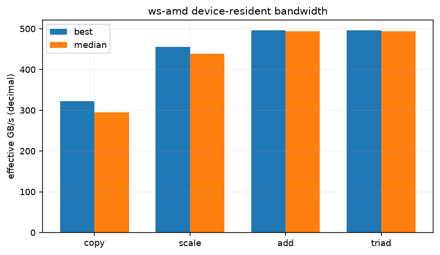

# Device-resident STREAM-style bandwidth

See commands.txt for the exact NUMA prefix and compiler invocation. Three 128 MiB float arrays, five warm-ups per operation, 31 repetitions timed by device events. GB/s is decimal and counts algorithmic read/write bytes; it is an effective bandwidth, not a DRAM counter. These are new workstation experiments, separate from the pass rows.

| operation | total array MiB | best ms | median ms | best GB/s | median GB/s |
|---|---|---|---|---|---|
| copy | 384 | 0.8326 | 0.9112 | 322.40 | 294.58 |
| scale | 384 | 0.5884 | 0.6116 | 456.18 | 438.93 |
| add | 384 | 0.8117 | 0.8156 | 496.07 | 493.66 |
| triad | 384 | 0.8114 | 0.8147 | 496.26 | 494.24 |

versions.txt:

```text
HIP version: 7.2.53211-97f5574fe2
AMD clang version 22.0.0git (https://github.com/RadeonOpenCompute/llvm-project roc-7.2.4 26084 f58b06dce1f9c15707c5f808fd002e18c2accf7e)
Target: x86_64-unknown-linux-gnu
Thread model: posix
InstalledDir: /opt/rocm-7.2.4/lib/llvm/bin
Configuration file: /opt/rocm-7.2.4/lib/llvm/bin/clang++.cfg
Python 3.12.3
7.3.0-363.vanilla.fc44.x86_64+rt

```

commands.txt:

```text
hipcc -O3 -std=c++17 --offload-arch=gfx1100 -x hip scripts/stream-probe.cu -o stream-probe
./stream-probe (three 128 MiB arrays, 31 repetitions)

```

## Conditions and limits

ws-amd; kernel `7.3.0-363.vanilla.fc44.x86_64+rt`; CPU maximum 2800000 kHz; boost=0; binding `numactl --cpunodebind=0 --membind=0`; process nice=19; NUMA balancing=None. GPU clocks were observed, not changed; snapshots are in conditions.json and any runtime monitors.

Other host services were running; their CPU and GPU use is not controlled. Kernel 7.3.0 differs from the 7.2.3 pass; GPU timings on 7.3.0 were 20–50% slower and noisier. These experiments prioritise counters. Timings and bandwidth describe this run only, not a programming-model speedup against the pass. CPU cap/boost were left unchanged.

GPU clock snapshot at collection start (not a clock lock or a time average):

```text
{
  "/sys/class/drm/card1/device/pp_dpm_sclk": "S: 38Mhz *\n1: 500Mhz \n2: 2526Mhz",
  "/sys/class/drm/card1/device/pp_dpm_mclk": "0: 96Mhz *\n1: 456Mhz \n2: 772Mhz \n3: 1249Mhz",
  "/sys/class/drm/card1/device/power_dpm_force_performance_level": "auto"
}
```

commands.txt:

```text
hipcc -O3 -std=c++17 --offload-arch=gfx1100 -x hip scripts/stream-probe.cu -o stream-probe
./stream-probe (three 128 MiB arrays, 31 repetitions)

```

versions.txt:

```text
HIP version: 7.2.53211-97f5574fe2
AMD clang version 22.0.0git (https://github.com/RadeonOpenCompute/llvm-project roc-7.2.4 26084 f58b06dce1f9c15707c5f808fd002e18c2accf7e)
Target: x86_64-unknown-linux-gnu
Thread model: posix
InstalledDir: /opt/rocm-7.2.4/lib/llvm/bin
Configuration file: /opt/rocm-7.2.4/lib/llvm/bin/clang++.cfg
Python 3.12.3
7.3.0-363.vanilla.fc44.x86_64+rt

```




