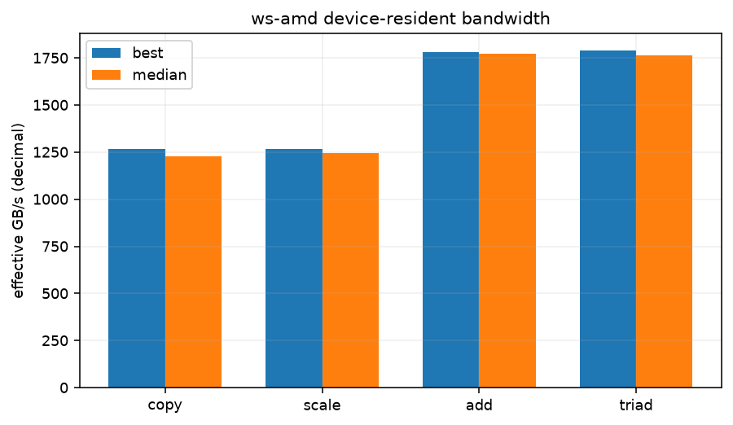

# Device-resident STREAM-style bandwidth

See commands.txt for the exact NUMA prefix and compiler invocation. Three device-resident float arrays (size in the table), five warm-ups per operation, and repeated device-event timings. GB/s is decimal and counts algorithmic read/write bytes; it is an effective bandwidth, not a DRAM counter. These are new workstation experiments, separate from the pass rows.

| operation | total array MiB | best ms | median ms | best GB/s | median GB/s |
|---|---|---|---|---|---|
| copy | 72 | 0.0398 | 0.0410 | 1265.85 | 1228.77 |
| scale | 72 | 0.0397 | 0.0405 | 1267.13 | 1243.34 |
| add | 72 | 0.0424 | 0.0426 | 1782.24 | 1770.54 |
| triad | 72 | 0.0422 | 0.0428 | 1789.00 | 1765.61 |

versions.txt:

```text
HIP version: 7.2.53211-97f5574fe2
AMD clang version 22.0.0git (https://github.com/RadeonOpenCompute/llvm-project roc-7.2.4 26084 f58b06dce1f9c15707c5f808fd002e18c2accf7e)
Target: x86_64-unknown-linux-gnu
Thread model: posix
InstalledDir: /opt/rocm-7.2.4/lib/llvm/bin
Configuration file: /opt/rocm-7.2.4/lib/llvm/bin/clang++.cfg
Python 3.12.3
7.2.3-300.vanilla.fc44.x86_64+rt

```

commands.txt:

```text
results/ws-amd/stream-2026-11-06/stream-probe 6291456 31 (72 MiB total; profile_standard)
rocprofv3 --kernel-trace --pmc FETCH_SIZE --kernel-include-regex .\*stream_op\<3\>.\* --output-format csv -d results/ws-amd/stream-cache-stable-2026-11-06/FETCH_SIZE -o run -- results/ws-amd/stream-2026-11-06/stream-probe 6291456 3 
rocprofv3 --kernel-trace --pmc WRITE_SIZE --kernel-include-regex .\*stream_op\<3\>.\* --output-format csv -d results/ws-amd/stream-cache-stable-2026-11-06/WRITE_SIZE -o run -- results/ws-amd/stream-2026-11-06/stream-probe 6291456 3 

```

## Conditions and limits

ws-amd; kernel `7.2.3-300.vanilla.fc44.x86_64+rt`; CPU maximum 2800000 kHz; boost=0; binding `numactl --cpunodebind=0 --membind=0; GPU profile_standard`; process nice=0; NUMA balancing=None. GPU policy and clock snapshots are in conditions.json and any runtime monitors. A profiling policy named in the binding was temporary and released after the run.

Other host services were running; their CPU and GPU use is not controlled. Same kernel, CPU cap and boost setting as the pass. These experiments prioritise counters. Timings and bandwidth describe this run only, not a programming-model speedup against the pass.

GPU clock snapshot at collection start (not a clock lock or a time average):

```text
{
  "/sys/class/drm/card1/device/pp_dpm_sclk": "0: 500Mhz \n1: 1977Mhz *\n2: 2526Mhz",
  "/sys/class/drm/card1/device/pp_dpm_mclk": "0: 96Mhz \n1: 456Mhz \n2: 772Mhz \n3: 1249Mhz *",
  "/sys/class/drm/card1/device/power_dpm_force_performance_level": "profile_standard"
}
```

commands.txt:

```text
results/ws-amd/stream-2026-11-06/stream-probe 6291456 31 (72 MiB total; profile_standard)
rocprofv3 --kernel-trace --pmc FETCH_SIZE --kernel-include-regex .\*stream_op\<3\>.\* --output-format csv -d results/ws-amd/stream-cache-stable-2026-11-06/FETCH_SIZE -o run -- results/ws-amd/stream-2026-11-06/stream-probe 6291456 3 
rocprofv3 --kernel-trace --pmc WRITE_SIZE --kernel-include-regex .\*stream_op\<3\>.\* --output-format csv -d results/ws-amd/stream-cache-stable-2026-11-06/WRITE_SIZE -o run -- results/ws-amd/stream-2026-11-06/stream-probe 6291456 3 

```

versions.txt:

```text
HIP version: 7.2.53211-97f5574fe2
AMD clang version 22.0.0git (https://github.com/RadeonOpenCompute/llvm-project roc-7.2.4 26084 f58b06dce1f9c15707c5f808fd002e18c2accf7e)
Target: x86_64-unknown-linux-gnu
Thread model: posix
InstalledDir: /opt/rocm-7.2.4/lib/llvm/bin
Configuration file: /opt/rocm-7.2.4/lib/llvm/bin/clang++.cfg
Python 3.12.3
7.2.3-300.vanilla.fc44.x86_64+rt

```

## Interface-matched roofline calibration

The 72 MiB working set exceeds L2 and fits within the RX 7900 XTX's 96 MiB Infinity Cache. The same FETCH_SIZE/WRITE_SIZE counters as the GEMM runs report median read/write traffic 48.000/22.599 MiB; the median of the two groups' kernel-duration medians is 34.461 us. Their matched reference is **2148.21 GB/s**. The ordinary event-timed logical-byte triad result is 1765.61 GB/s. These are different measurement boundaries. This calibration supports a GL2 external-interface roofline, not a DRAM-only roofline; the independent 384 MiB probe remains the large-buffer bandwidth experiment. Raw samples and the formula are in calibration.json.


