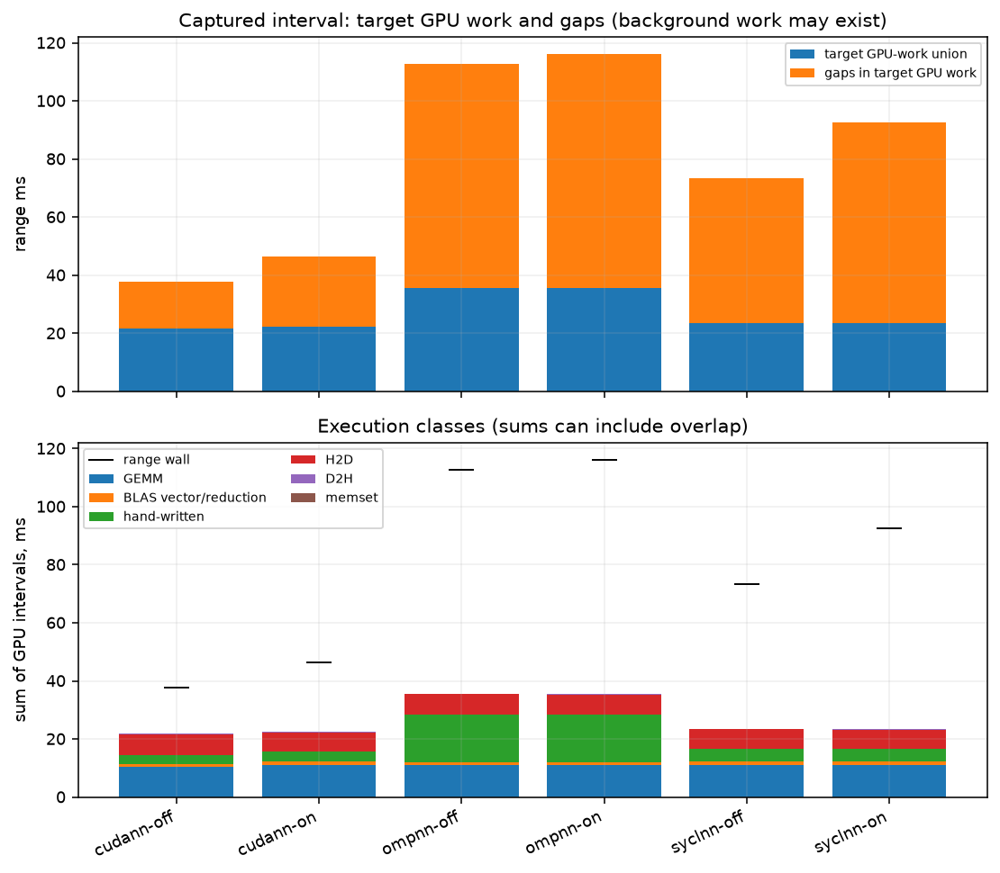
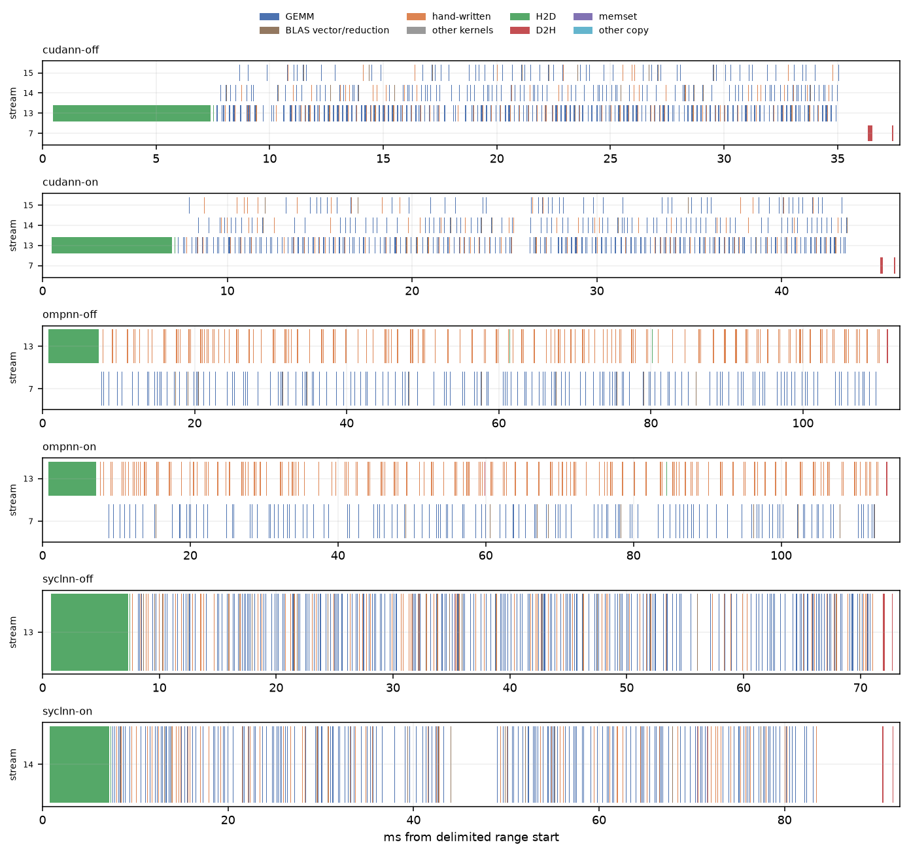

# Delimited training profiles

Exact nsys and driver commands are in commands.txt and each driver JSON. MNIST 784–512–256–10, float, B=256, N=8192; backends cudann/nvcc, syclnn/DPC++, and ompnn/clang18nv. warm-up excluded, one captured train(epochs=2): upload, first epoch, one steady epoch. The internal phase counters cover this entire call, not the steady epoch alone.

Range wall comes from CUDA profiler API boundaries when present, otherwise the explicitly named NVTX train interval inside that capture (boundary source is shown). No first-to-last-GPU-event wall estimate. Busy is the union of this process’s GPU intervals clipped to that range; overlap is sum minus union; idle is range minus union. Host API time is a union per thread, then summed across threads; nested runtime/driver API calls are not double-counted in that time. API call counts include both layers. The target-work gaps are not evidence that the physical GPU was idle: background services may use it.

| capture | range boundary | range ms | whole train ms | GEMM ms | BLAS vector/reduction ms | hand-written ms | other kernels ms | H2D ms | D2H ms | memset ms | busy union ms | overlap ms | idle ms | kernel launches |
|---|---|---|---|---|---|---|---|---|---|---|---|---|---|---|
| cudann-off | NVTX train interval inside CUDA capture | 37.7459 | 37.7169 | 10.3337 | 0.9724 | 3.1939 | 0.0000 | 6.9862 | 0.2681 | 0.0016 | 21.4958 | 0.2601 | 16.2501 | 1280 |
| cudann-on | NVTX train interval inside CUDA capture | 46.4058 | 46.3567 | 11.1673 | 1.0529 | 3.3480 | 0.0000 | 6.5559 | 0.2206 | 0.0017 | 22.2924 | 0.0541 | 24.1134 | 1280 |
| ompnn-off | NVTX train interval inside CUDA capture | 112.7625 | 112.7349 | 11.0969 | 0.9747 | 16.4545 | 0.0000 | 6.8447 | 0.2815 | 0.0000 | 35.6524 | 0.0000 | 77.1101 | 1280 |
| ompnn-on | NVTX train interval inside CUDA capture | 116.0856 | 116.0586 | 11.0968 | 0.9742 | 16.4651 | 0.0000 | 6.7427 | 0.2758 | 0.0000 | 35.5546 | 0.0000 | 80.5310 | 1280 |
| syclnn-off | NVTX train interval inside CUDA capture | 73.3959 | 73.3703 | 11.1054 | 1.0636 | 4.4906 | 0.0000 | 6.6362 | 0.2257 | 0.0507 | 23.5722 | 0.0000 | 49.8236 | 1280 |
| syclnn-on | NVTX train interval inside CUDA capture | 92.4451 | 92.4187 | 11.1189 | 1.0749 | 4.5004 | 0.0000 | 6.4527 | 0.2282 | 0.0506 | 23.4256 | 0.0000 | 69.0195 | 1280 |

| capture | launch API calls | launch host thread-ms | sync API calls | sync host thread-ms | first / steady epoch internal wall ms |
|---|---|---|---|---|---|
| cudann-off | 1280 | 13.1081 | 545 | 0.9184 | 14.8147 / 12.7457 |
| cudann-on | 1280 | 11.7762 | 545 | 0.9124 | 19.0976 / 18.0491 |
| ompnn-off | 1280 | 18.9622 | 1352 | 51.1357 | 52.3472 / 50.1510 |
| ompnn-on | 1280 | 19.6697 | 1352 | 52.2052 | 53.4962 / 52.1753 |
| syclnn-off | 1280 | 17.3041 | 202 | 0.2955 | 30.6655 / 32.9768 |
| syclnn-on | 1280 | 14.2454 | 7953 | 4.2674 | 41.4742 / 39.9309 |

Internal profiler attribution, ms over the same two-epoch call (including upload where attributed). CUDA stream-event intervals, SYCL command timestamps, OpenMP synchronous host intervals. These are not an additive partition of wall time. OpenMP loss includes its implicit D2H readback.

| capture | gemm | act | delta | biasgrad | update | loss | reg | h2d | d2h | other | wall |
|---|---|---|---|---|---|---|---|---|---|---|---|
| cudann-off | disabled | disabled | disabled | disabled | disabled | disabled | disabled | disabled | disabled | disabled | disabled |
| cudann-on | 16.6575 | 1.6489 | 1.3298 | 3.6248 | 4.2987 | 0.8589 | 0.0000 | 7.0694 | 0.0279 | 0.0350 | 46.2291 |
| ompnn-off | disabled | disabled | disabled | disabled | disabled | disabled | disabled | disabled | disabled | disabled | disabled |
| ompnn-on | 35.8843 | 13.8067 | 8.9603 | 9.8939 | 27.7824 | 8.8350 | 0.0000 | 7.1334 | 0.0000 | 0.0000 | 115.6296 |
| syclnn-off | disabled | disabled | disabled | disabled | disabled | disabled | disabled | disabled | disabled | disabled | disabled |
| syclnn-on | 20.2020 | 2.3444 | 1.6979 | 6.3888 | 4.1342 | 2.1149 | 0.0000 | 6.8586 | 0.9149 | 0.0321 | 91.9655 |

versions.txt:

```text
NVIDIA Nsight Systems version 2025.1.3.140-251335620677v0
NVIDIA Nsight Systems version 2025.1.3.140-251335620677v0
NVIDIA Nsight Systems version 2025.1.3.140-251335620677v0

```

## Conditions and limits

ws-nvidia; kernel `7.2.11-200.fc44.x86_64`; CPU maximum not exposed by guest kHz; boost=None; binding `numactl --cpunodebind=1 --membind=1`; process nice=0; NUMA balancing=0. GPU policy and clock snapshots are in conditions.json and any runtime monitors. A profiling policy named in the binding was temporary and released after the run.

other services were running on the host and in the VM, as in every ws-nvidia pass; their CPU and GPU use is not controlled. The GPU was not dedicated to the benchmark. Pascal GPU; other GPU work remains possible. Bench mode only changes the listed runtime settings. No comparisons with the historical pass assume identical conditions.

GPU clock snapshot at collection start (not a clock lock or a time average):

```text
{
  "command": [
    "nvidia-smi",
    "--query-gpu=name,driver_version,clocks.current.sm,clocks.current.memory,power.draw,temperature.gpu,utilization.gpu,utilization.memory",
    "--format=csv"
  ],
  "exit": 0,
  "stdout": "name, driver_version, clocks.current.sm [MHz], clocks.current.memory [MHz], power.draw [W], temperature.gpu, utilization.gpu [%], utilization.memory [%]\nNVIDIA GeForce GTX 1080 Ti, 580.196.07, 1733 MHz, 5005 MHz, 69.46 W, 53, 2 %, 1 %",
  "stderr": ""
}
```

commands.txt:

```text
bash scripts/ws-nvidia-extras.sh nsys-epoch 2026-11-04
/opt/nvidia/nsight-systems/2025.1.3/target-linux-x64/nsys profile --trace=cuda,nvtx --sample=none --cpuctxsw=none --capture-range=cudaProfilerApi --capture-range-end=stop --force-overwrite true -o results/ws-nvidia/nsys-epoch-2026-11-04/cudann-off python scripts/nsys_epoch.py --backend cudann --nvtx-lib /work/fnn-bench/results/ws-nvidia/nsys-epoch-2026-11-04/nvtx-range.so --out results/ws-nvidia/nsys-epoch-2026-11-04/cudann-off.json
/opt/nvidia/nsight-systems/2025.1.3/target-linux-x64/nsys export --type sqlite --force-overwrite true -o results/ws-nvidia/nsys-epoch-2026-11-04/cudann-off.sqlite results/ws-nvidia/nsys-epoch-2026-11-04/cudann-off.nsys-rep
/opt/nvidia/nsight-systems/2025.1.3/target-linux-x64/nsys stats --report cuda_gpu_trace --format csv -o results/ws-nvidia/nsys-epoch-2026-11-04/cudann-off-gpu results/ws-nvidia/nsys-epoch-2026-11-04/cudann-off.sqlite
/opt/nvidia/nsight-systems/2025.1.3/target-linux-x64/nsys stats --report cuda_api_sum --format csv -o results/ws-nvidia/nsys-epoch-2026-11-04/cudann-off-api results/ws-nvidia/nsys-epoch-2026-11-04/cudann-off.sqlite
/opt/nvidia/nsight-systems/2025.1.3/target-linux-x64/nsys profile --trace=cuda,nvtx --sample=none --cpuctxsw=none --capture-range=cudaProfilerApi --capture-range-end=stop --force-overwrite true -o results/ws-nvidia/nsys-epoch-2026-11-04/cudann-on python scripts/nsys_epoch.py --backend cudann --nvtx-lib /work/fnn-bench/results/ws-nvidia/nsys-epoch-2026-11-04/nvtx-range.so --out results/ws-nvidia/nsys-epoch-2026-11-04/cudann-on.json --profile
/opt/nvidia/nsight-systems/2025.1.3/target-linux-x64/nsys export --type sqlite --force-overwrite true -o results/ws-nvidia/nsys-epoch-2026-11-04/cudann-on.sqlite results/ws-nvidia/nsys-epoch-2026-11-04/cudann-on.nsys-rep
/opt/nvidia/nsight-systems/2025.1.3/target-linux-x64/nsys stats --report cuda_gpu_trace --format csv -o results/ws-nvidia/nsys-epoch-2026-11-04/cudann-on-gpu results/ws-nvidia/nsys-epoch-2026-11-04/cudann-on.sqlite
/opt/nvidia/nsight-systems/2025.1.3/target-linux-x64/nsys stats --report cuda_api_sum --format csv -o results/ws-nvidia/nsys-epoch-2026-11-04/cudann-on-api results/ws-nvidia/nsys-epoch-2026-11-04/cudann-on.sqlite
/opt/nvidia/nsight-systems/2025.1.3/target-linux-x64/nsys profile --trace=cuda,nvtx --sample=none --cpuctxsw=none --capture-range=cudaProfilerApi --capture-range-end=stop --force-overwrite true -o results/ws-nvidia/nsys-epoch-2026-11-04/syclnn-off python scripts/nsys_epoch.py --backend syclnn --nvtx-lib /work/fnn-bench/results/ws-nvidia/nsys-epoch-2026-11-04/nvtx-range.so --out results/ws-nvidia/nsys-epoch-2026-11-04/syclnn-off.json
/opt/nvidia/nsight-systems/2025.1.3/target-linux-x64/nsys export --type sqlite --force-overwrite true -o results/ws-nvidia/nsys-epoch-2026-11-04/syclnn-off.sqlite results/ws-nvidia/nsys-epoch-2026-11-04/syclnn-off.nsys-rep
/opt/nvidia/nsight-systems/2025.1.3/target-linux-x64/nsys stats --report cuda_gpu_trace --format csv -o results/ws-nvidia/nsys-epoch-2026-11-04/syclnn-off-gpu results/ws-nvidia/nsys-epoch-2026-11-04/syclnn-off.sqlite
/opt/nvidia/nsight-systems/2025.1.3/target-linux-x64/nsys stats --report cuda_api_sum --format csv -o results/ws-nvidia/nsys-epoch-2026-11-04/syclnn-off-api results/ws-nvidia/nsys-epoch-2026-11-04/syclnn-off.sqlite
/opt/nvidia/nsight-systems/2025.1.3/target-linux-x64/nsys profile --trace=cuda,nvtx --sample=none --cpuctxsw=none --capture-range=cudaProfilerApi --capture-range-end=stop --force-overwrite true -o results/ws-nvidia/nsys-epoch-2026-11-04/syclnn-on python scripts/nsys_epoch.py --backend syclnn --nvtx-lib /work/fnn-bench/results/ws-nvidia/nsys-epoch-2026-11-04/nvtx-range.so --out results/ws-nvidia/nsys-epoch-2026-11-04/syclnn-on.json --profile
/opt/nvidia/nsight-systems/2025.1.3/target-linux-x64/nsys export --type sqlite --force-overwrite true -o results/ws-nvidia/nsys-epoch-2026-11-04/syclnn-on.sqlite results/ws-nvidia/nsys-epoch-2026-11-04/syclnn-on.nsys-rep
/opt/nvidia/nsight-systems/2025.1.3/target-linux-x64/nsys stats --report cuda_gpu_trace --format csv -o results/ws-nvidia/nsys-epoch-2026-11-04/syclnn-on-gpu results/ws-nvidia/nsys-epoch-2026-11-04/syclnn-on.sqlite
/opt/nvidia/nsight-systems/2025.1.3/target-linux-x64/nsys stats --report cuda_api_sum --format csv -o results/ws-nvidia/nsys-epoch-2026-11-04/syclnn-on-api results/ws-nvidia/nsys-epoch-2026-11-04/syclnn-on.sqlite
/opt/nvidia/nsight-systems/2025.1.3/target-linux-x64/nsys profile --trace=cuda,nvtx --sample=none --cpuctxsw=none --capture-range=cudaProfilerApi --capture-range-end=stop --force-overwrite true -o results/ws-nvidia/nsys-epoch-2026-11-04/ompnn-off python scripts/nsys_epoch.py --backend ompnn --nvtx-lib /work/fnn-bench/results/ws-nvidia/nsys-epoch-2026-11-04/nvtx-range.so --out results/ws-nvidia/nsys-epoch-2026-11-04/ompnn-off.json
/opt/nvidia/nsight-systems/2025.1.3/target-linux-x64/nsys export --type sqlite --force-overwrite true -o results/ws-nvidia/nsys-epoch-2026-11-04/ompnn-off.sqlite results/ws-nvidia/nsys-epoch-2026-11-04/ompnn-off.nsys-rep
/opt/nvidia/nsight-systems/2025.1.3/target-linux-x64/nsys stats --report cuda_gpu_trace --format csv -o results/ws-nvidia/nsys-epoch-2026-11-04/ompnn-off-gpu results/ws-nvidia/nsys-epoch-2026-11-04/ompnn-off.sqlite
/opt/nvidia/nsight-systems/2025.1.3/target-linux-x64/nsys stats --report cuda_api_sum --format csv -o results/ws-nvidia/nsys-epoch-2026-11-04/ompnn-off-api results/ws-nvidia/nsys-epoch-2026-11-04/ompnn-off.sqlite
/opt/nvidia/nsight-systems/2025.1.3/target-linux-x64/nsys profile --trace=cuda,nvtx --sample=none --cpuctxsw=none --capture-range=cudaProfilerApi --capture-range-end=stop --force-overwrite true -o results/ws-nvidia/nsys-epoch-2026-11-04/ompnn-on python scripts/nsys_epoch.py --backend ompnn --nvtx-lib /work/fnn-bench/results/ws-nvidia/nsys-epoch-2026-11-04/nvtx-range.so --out results/ws-nvidia/nsys-epoch-2026-11-04/ompnn-on.json --profile
/opt/nvidia/nsight-systems/2025.1.3/target-linux-x64/nsys export --type sqlite --force-overwrite true -o results/ws-nvidia/nsys-epoch-2026-11-04/ompnn-on.sqlite results/ws-nvidia/nsys-epoch-2026-11-04/ompnn-on.nsys-rep
/opt/nvidia/nsight-systems/2025.1.3/target-linux-x64/nsys stats --report cuda_gpu_trace --format csv -o results/ws-nvidia/nsys-epoch-2026-11-04/ompnn-on-gpu results/ws-nvidia/nsys-epoch-2026-11-04/ompnn-on.sqlite
/opt/nvidia/nsight-systems/2025.1.3/target-linux-x64/nsys stats --report cuda_api_sum --format csv -o results/ws-nvidia/nsys-epoch-2026-11-04/ompnn-on-api results/ws-nvidia/nsys-epoch-2026-11-04/ompnn-on.sqlite

```

versions.txt:

```text
NVIDIA Nsight Systems version 2025.1.3.140-251335620677v0
NVIDIA Nsight Systems version 2025.1.3.140-251335620677v0
NVIDIA Nsight Systems version 2025.1.3.140-251335620677v0

```

bench-mode-status.txt:

```text
the host 2026-11-04T01:51:19+01:00
cpufreq: driver=intel_cpufreq intel_pstate=passive no_turbo=1 min_perf_pct=92 max_perf_pct=100
  policies: 24 governor=performance min=3500000 max=3500000
  scaling_cur_freq kHz (cpu0..23): 3500231 3500628 3500277 3500638 3500278 3501052 3500288 3499728 3500105 3500165 3500232 3500278 3500262 3501100 3500000 3500357 3500000 3500278 3499124 3500212 3499662 3500269 3500354 3501794
cpuidle: driver=intel_idle governor=menu cpu_dma_latency=1us (tuned: my-latency-performance)
  idle states allowed by PM QoS: POLL C1
kernel.numa_balancing=0 ksm.run=0 ksm.pages_sharing=0 zone_reclaim_mode=0 swappiness=10 swap=0kB
THP enabled=madvise defrag=never
node0 2M hugepages total=0 free=0  node1 2M hugepages total=0 free=0
ZFS ARC c_max=90.0 GiB size=50.6 GiB
zfs_arc_max param=96636764160
the VM: running (booted)  hugepage guard: inactive
```

background-host.txt:

```text
other services were running on the host and in the VM, as in every ws-nvidia pass; their CPU and GPU use is not controlled.
The GPU was not dedicated to the benchmark.
```

## Recorded implementation versions

cudann 0.1.2 (nvcc 12.9.86, host GNU 13.3.0) and syclnn 0.2.2 (DPC++/Clang 22.1.0, oneMath source tag v0.9, exported CMake package version 0.5.0) both map cuBLAS 12.9.2.10. The Nsight OpenMP path is ompnn 0.1.1, Clang 18.1.3 nvptx sm_61, using the same cuBLAS version. Full flags, effective options and mapped libraries remain in the run/driver JSON files. Timing rows and traced/profiled rows retain their own measurement boundaries.





The oneMath tag v0.9 declares `project(oneMath VERSION 0.5.0)`. The installed `oneMathConfigVersion.cmake` exports that package version, which `syclnn.build_info().onemath` records via `find_package(oneMath)`. The same package metadata is used by the DPC++ and AdaptiveCpp builds; this experiment used DPC++.
