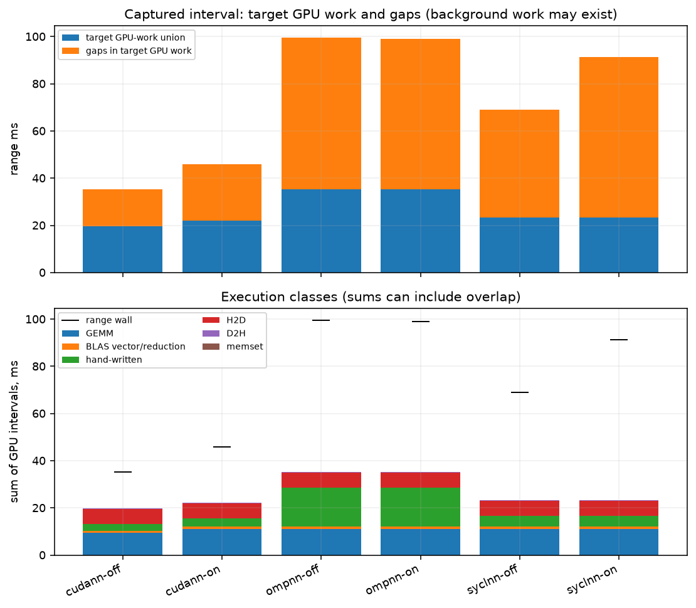
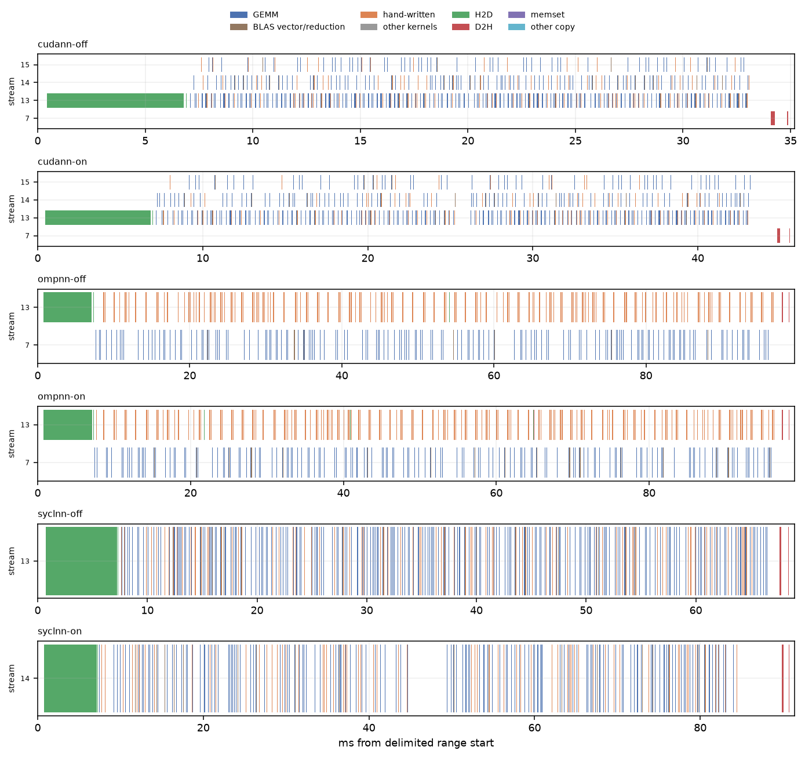

# Delimited training profiles

Exact nsys and driver commands are in commands.txt and each driver JSON. MNIST 784–512–256–10, float, B=256, N=8192; backends cudann/nvcc, syclnn/DPC++, and ompnn/clang18nv. warm-up excluded, one captured train(epochs=2): upload, first epoch, one steady epoch. The internal phase counters cover this entire call, not the steady epoch alone.

Range wall comes from CUDA profiler API boundaries when present, otherwise the explicitly named NVTX train interval inside that capture (boundary source is shown). No first-to-last-GPU-event wall estimate. Busy is the union of this process’s GPU intervals clipped to that range; overlap is sum minus union; idle is range minus union. Host API time is a union per thread, then summed across threads; nested runtime/driver API calls are not double-counted in that time. API call counts include both layers. The target-work gaps are not evidence that the physical GPU was idle: background services may use it.

| capture | range boundary | range ms | whole train ms | GEMM ms | BLAS vector/reduction ms | hand-written ms | other kernels ms | H2D ms | D2H ms | memset ms | busy union ms | overlap ms | idle ms | kernel launches |
|---|---|---|---|---|---|---|---|---|---|---|---|---|---|---|
| cudann-off | NVTX train interval inside CUDA capture | 35.1795 | 35.1552 | 9.3624 | 0.8894 | 3.0026 | 0.0000 | 6.4080 | 0.2396 | 0.0013 | 19.7195 | 0.1837 | 15.4600 | 1280 |
| cudann-on | NVTX train interval inside CUDA capture | 45.8546 | 45.8304 | 11.1040 | 1.0402 | 3.3110 | 0.0000 | 6.4242 | 0.2392 | 0.0015 | 22.1174 | 0.0027 | 23.7373 | 1280 |
| ompnn-off | NVTX train interval inside CUDA capture | 99.5235 | 99.5000 | 11.0421 | 0.9702 | 16.4675 | 0.0000 | 6.5779 | 0.2871 | 0.0000 | 35.3447 | 0.0000 | 64.1788 | 1280 |
| ompnn-on | NVTX train interval inside CUDA capture | 99.0078 | 98.9839 | 11.0388 | 0.9717 | 16.4701 | 0.0000 | 6.5597 | 0.2941 | 0.0000 | 35.3344 | 0.0000 | 63.6734 | 1280 |
| syclnn-off | NVTX train interval inside CUDA capture | 68.9944 | 68.9730 | 11.0600 | 1.0221 | 4.4731 | 0.0000 | 6.4986 | 0.2379 | 0.0479 | 23.3396 | 0.0000 | 45.6548 | 1280 |
| syclnn-on | NVTX train interval inside CUDA capture | 91.3753 | 91.3518 | 11.0732 | 1.0256 | 4.4822 | 0.0000 | 6.3918 | 0.2392 | 0.0479 | 23.2599 | 0.0000 | 68.1154 | 1280 |

| capture | launch API calls | launch host thread-ms | sync API calls | sync host thread-ms | first / steady epoch internal wall ms |
|---|---|---|---|---|---|
| cudann-off | 1280 | 12.3744 | 545 | 0.8942 | 13.2989 / 12.9293 |
| cudann-on | 1280 | 11.6650 | 545 | 0.9015 | 19.1630 / 17.7494 |
| ompnn-off | 1280 | 16.2718 | 1352 | 47.4224 | 45.0070 / 44.4905 |
| ompnn-on | 1280 | 15.7882 | 1352 | 47.8849 | 44.6451 / 44.3784 |
| syclnn-off | 1280 | 16.1704 | 200 | 0.3328 | 30.1050 / 29.3440 |
| syclnn-on | 1280 | 14.4855 | 7952 | 3.8386 | 41.9483 / 39.5604 |

Internal profiler attribution, ms over the same two-epoch call (including upload where attributed). CUDA stream-event intervals, SYCL command timestamps, OpenMP synchronous host intervals. These are not an additive partition of wall time. OpenMP loss includes its implicit D2H readback.

| capture | gemm | act | delta | biasgrad | update | loss | reg | h2d | d2h | other | wall |
|---|---|---|---|---|---|---|---|---|---|---|---|
| cudann-off | disabled | disabled | disabled | disabled | disabled | disabled | disabled | disabled | disabled | disabled | disabled |
| cudann-on | 16.6139 | 1.5590 | 1.3326 | 3.6332 | 4.3512 | 0.9012 | 0.0000 | 6.8576 | 0.0280 | 0.0346 | 45.6918 |
| ompnn-off | disabled | disabled | disabled | disabled | disabled | disabled | disabled | disabled | disabled | disabled | disabled |
| ompnn-on | 30.6275 | 10.2632 | 7.4924 | 8.5409 | 25.2569 | 6.4336 | 0.0000 | 6.9764 | 0.0000 | 0.0000 | 98.6236 |
| syclnn-off | disabled | disabled | disabled | disabled | disabled | disabled | disabled | disabled | disabled | disabled | disabled |
| syclnn-on | 19.8800 | 2.3983 | 1.8121 | 6.8865 | 4.0111 | 2.0802 | 0.0000 | 6.8182 | 0.7568 | 0.0325 | 90.9846 |

versions.txt:

```text
NVIDIA Nsight Systems version 2025.1.3.140-251335620677v0
NVIDIA Nsight Systems version 2025.1.3.140-251335620677v0
NVIDIA Nsight Systems version 2025.1.3.140-251335620677v0

```

## Conditions and limits

ws-nvidia; kernel `7.2.11-200.fc44.x86_64`; CPU maximum not exposed by guest kHz; boost=None; binding `numactl --cpunodebind=1 --membind=1`; process nice=0; NUMA balancing=0. GPU policy and clock snapshots are in conditions.json and any runtime monitors. A profiling policy named in the binding was temporary and released after the run.

other services were running on the host and in the VM, as in every ws-nvidia pass; their CPU use is not controlled. Pascal GPU. Bench mode only changes the listed runtime settings. No comparisons with the historical pass assume identical conditions.

GPU clock snapshot at collection start (not a clock lock or a time average):

```text
{
  "command": [
    "nvidia-smi",
    "--query-gpu=name,driver_version,clocks.current.sm,clocks.current.memory,power.draw,temperature.gpu,utilization.gpu,utilization.memory",
    "--format=csv"
  ],
  "exit": 0,
  "stdout": "name, driver_version, clocks.current.sm [MHz], clocks.current.memory [MHz], power.draw [W], temperature.gpu, utilization.gpu [%], utilization.memory [%]\nNVIDIA GeForce GTX 1080 Ti, 580.196.07, 1974 MHz, 5508 MHz, 84.87 W, 56, 0 %, 0 %",
  "stderr": ""
}
```

No other process used the GPU during this run.

commands.txt:

```text
bash scripts/ws-nvidia-extras.sh nsys-epoch 2026-11-06
/opt/nvidia/nsight-systems/2025.1.3/target-linux-x64/nsys profile --trace=cuda,nvtx --sample=none --cpuctxsw=none --capture-range=cudaProfilerApi --capture-range-end=stop --force-overwrite true -o results/ws-nvidia/nsys-epoch-2026-11-06/cudann-off python scripts/nsys_epoch.py --backend cudann --nvtx-lib /work/fnn-bench/results/ws-nvidia/nsys-epoch-2026-11-06/nvtx-range.so --out results/ws-nvidia/nsys-epoch-2026-11-06/cudann-off.json
/opt/nvidia/nsight-systems/2025.1.3/target-linux-x64/nsys export --type sqlite --force-overwrite true -o results/ws-nvidia/nsys-epoch-2026-11-06/cudann-off.sqlite results/ws-nvidia/nsys-epoch-2026-11-06/cudann-off.nsys-rep
/opt/nvidia/nsight-systems/2025.1.3/target-linux-x64/nsys stats --report cuda_gpu_trace --format csv -o results/ws-nvidia/nsys-epoch-2026-11-06/cudann-off-gpu results/ws-nvidia/nsys-epoch-2026-11-06/cudann-off.sqlite
/opt/nvidia/nsight-systems/2025.1.3/target-linux-x64/nsys stats --report cuda_api_sum --format csv -o results/ws-nvidia/nsys-epoch-2026-11-06/cudann-off-api results/ws-nvidia/nsys-epoch-2026-11-06/cudann-off.sqlite
/opt/nvidia/nsight-systems/2025.1.3/target-linux-x64/nsys profile --trace=cuda,nvtx --sample=none --cpuctxsw=none --capture-range=cudaProfilerApi --capture-range-end=stop --force-overwrite true -o results/ws-nvidia/nsys-epoch-2026-11-06/cudann-on python scripts/nsys_epoch.py --backend cudann --nvtx-lib /work/fnn-bench/results/ws-nvidia/nsys-epoch-2026-11-06/nvtx-range.so --out results/ws-nvidia/nsys-epoch-2026-11-06/cudann-on.json --profile
/opt/nvidia/nsight-systems/2025.1.3/target-linux-x64/nsys export --type sqlite --force-overwrite true -o results/ws-nvidia/nsys-epoch-2026-11-06/cudann-on.sqlite results/ws-nvidia/nsys-epoch-2026-11-06/cudann-on.nsys-rep
/opt/nvidia/nsight-systems/2025.1.3/target-linux-x64/nsys stats --report cuda_gpu_trace --format csv -o results/ws-nvidia/nsys-epoch-2026-11-06/cudann-on-gpu results/ws-nvidia/nsys-epoch-2026-11-06/cudann-on.sqlite
/opt/nvidia/nsight-systems/2025.1.3/target-linux-x64/nsys stats --report cuda_api_sum --format csv -o results/ws-nvidia/nsys-epoch-2026-11-06/cudann-on-api results/ws-nvidia/nsys-epoch-2026-11-06/cudann-on.sqlite
/opt/nvidia/nsight-systems/2025.1.3/target-linux-x64/nsys profile --trace=cuda,nvtx --sample=none --cpuctxsw=none --capture-range=cudaProfilerApi --capture-range-end=stop --force-overwrite true -o results/ws-nvidia/nsys-epoch-2026-11-06/syclnn-off python scripts/nsys_epoch.py --backend syclnn --nvtx-lib /work/fnn-bench/results/ws-nvidia/nsys-epoch-2026-11-06/nvtx-range.so --out results/ws-nvidia/nsys-epoch-2026-11-06/syclnn-off.json
/opt/nvidia/nsight-systems/2025.1.3/target-linux-x64/nsys export --type sqlite --force-overwrite true -o results/ws-nvidia/nsys-epoch-2026-11-06/syclnn-off.sqlite results/ws-nvidia/nsys-epoch-2026-11-06/syclnn-off.nsys-rep
/opt/nvidia/nsight-systems/2025.1.3/target-linux-x64/nsys stats --report cuda_gpu_trace --format csv -o results/ws-nvidia/nsys-epoch-2026-11-06/syclnn-off-gpu results/ws-nvidia/nsys-epoch-2026-11-06/syclnn-off.sqlite
/opt/nvidia/nsight-systems/2025.1.3/target-linux-x64/nsys stats --report cuda_api_sum --format csv -o results/ws-nvidia/nsys-epoch-2026-11-06/syclnn-off-api results/ws-nvidia/nsys-epoch-2026-11-06/syclnn-off.sqlite
/opt/nvidia/nsight-systems/2025.1.3/target-linux-x64/nsys profile --trace=cuda,nvtx --sample=none --cpuctxsw=none --capture-range=cudaProfilerApi --capture-range-end=stop --force-overwrite true -o results/ws-nvidia/nsys-epoch-2026-11-06/syclnn-on python scripts/nsys_epoch.py --backend syclnn --nvtx-lib /work/fnn-bench/results/ws-nvidia/nsys-epoch-2026-11-06/nvtx-range.so --out results/ws-nvidia/nsys-epoch-2026-11-06/syclnn-on.json --profile
/opt/nvidia/nsight-systems/2025.1.3/target-linux-x64/nsys export --type sqlite --force-overwrite true -o results/ws-nvidia/nsys-epoch-2026-11-06/syclnn-on.sqlite results/ws-nvidia/nsys-epoch-2026-11-06/syclnn-on.nsys-rep
/opt/nvidia/nsight-systems/2025.1.3/target-linux-x64/nsys stats --report cuda_gpu_trace --format csv -o results/ws-nvidia/nsys-epoch-2026-11-06/syclnn-on-gpu results/ws-nvidia/nsys-epoch-2026-11-06/syclnn-on.sqlite
/opt/nvidia/nsight-systems/2025.1.3/target-linux-x64/nsys stats --report cuda_api_sum --format csv -o results/ws-nvidia/nsys-epoch-2026-11-06/syclnn-on-api results/ws-nvidia/nsys-epoch-2026-11-06/syclnn-on.sqlite
/opt/nvidia/nsight-systems/2025.1.3/target-linux-x64/nsys profile --trace=cuda,nvtx --sample=none --cpuctxsw=none --capture-range=cudaProfilerApi --capture-range-end=stop --force-overwrite true -o results/ws-nvidia/nsys-epoch-2026-11-06/ompnn-off python scripts/nsys_epoch.py --backend ompnn --nvtx-lib /work/fnn-bench/results/ws-nvidia/nsys-epoch-2026-11-06/nvtx-range.so --out results/ws-nvidia/nsys-epoch-2026-11-06/ompnn-off.json
/opt/nvidia/nsight-systems/2025.1.3/target-linux-x64/nsys export --type sqlite --force-overwrite true -o results/ws-nvidia/nsys-epoch-2026-11-06/ompnn-off.sqlite results/ws-nvidia/nsys-epoch-2026-11-06/ompnn-off.nsys-rep
/opt/nvidia/nsight-systems/2025.1.3/target-linux-x64/nsys stats --report cuda_gpu_trace --format csv -o results/ws-nvidia/nsys-epoch-2026-11-06/ompnn-off-gpu results/ws-nvidia/nsys-epoch-2026-11-06/ompnn-off.sqlite
/opt/nvidia/nsight-systems/2025.1.3/target-linux-x64/nsys stats --report cuda_api_sum --format csv -o results/ws-nvidia/nsys-epoch-2026-11-06/ompnn-off-api results/ws-nvidia/nsys-epoch-2026-11-06/ompnn-off.sqlite
/opt/nvidia/nsight-systems/2025.1.3/target-linux-x64/nsys profile --trace=cuda,nvtx --sample=none --cpuctxsw=none --capture-range=cudaProfilerApi --capture-range-end=stop --force-overwrite true -o results/ws-nvidia/nsys-epoch-2026-11-06/ompnn-on python scripts/nsys_epoch.py --backend ompnn --nvtx-lib /work/fnn-bench/results/ws-nvidia/nsys-epoch-2026-11-06/nvtx-range.so --out results/ws-nvidia/nsys-epoch-2026-11-06/ompnn-on.json --profile
/opt/nvidia/nsight-systems/2025.1.3/target-linux-x64/nsys export --type sqlite --force-overwrite true -o results/ws-nvidia/nsys-epoch-2026-11-06/ompnn-on.sqlite results/ws-nvidia/nsys-epoch-2026-11-06/ompnn-on.nsys-rep
/opt/nvidia/nsight-systems/2025.1.3/target-linux-x64/nsys stats --report cuda_gpu_trace --format csv -o results/ws-nvidia/nsys-epoch-2026-11-06/ompnn-on-gpu results/ws-nvidia/nsys-epoch-2026-11-06/ompnn-on.sqlite
/opt/nvidia/nsight-systems/2025.1.3/target-linux-x64/nsys stats --report cuda_api_sum --format csv -o results/ws-nvidia/nsys-epoch-2026-11-06/ompnn-on-api results/ws-nvidia/nsys-epoch-2026-11-06/ompnn-on.sqlite

```

versions.txt:

```text
NVIDIA Nsight Systems version 2025.1.3.140-251335620677v0
NVIDIA Nsight Systems version 2025.1.3.140-251335620677v0
NVIDIA Nsight Systems version 2025.1.3.140-251335620677v0

```

background-host.txt:

```text
other services were running on the host and in the VM, as in every ws-nvidia pass; their CPU use is not controlled.
No other process used the GPU during this run.

```




