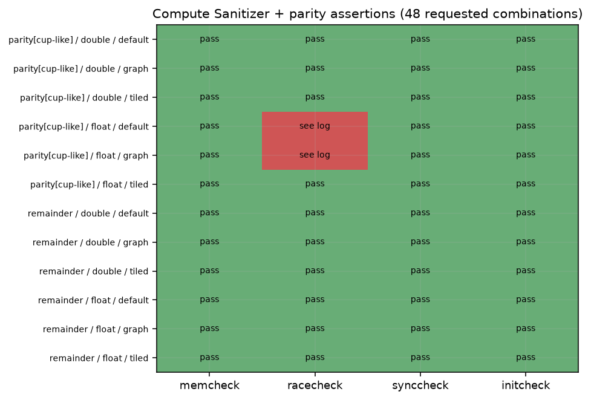

# Compute Sanitizer: small cudann parity cases

Shared fnn-testkit parity test (cup-like) and remainder-batch test (7 samples, batch 3), each in float and double, with default, queue=graph and blas=tiled. Each table row is a separate process. A pass requires both pytest success and a zero tool summary. Timeouts or missing summaries are not passes. Tools check only their supported error classes.

| case | dtype | options | tool | result | reported errors | warnings | displayed hazards | exit |
|---|---|---|---|---|---|---|---|---|
| test_parity_with_reference[cup-like] | float | default | initcheck | pass | 0 | 0 | - | 0 |
| test_remainder_batch | float | default | initcheck | pass | 0 | 0 | - | 0 |
| test_parity_with_reference[cup-like] | float | graph | initcheck | pass | 0 | 0 | - | 0 |
| test_remainder_batch | float | graph | initcheck | pass | 0 | 0 | - | 0 |
| test_parity_with_reference[cup-like] | float | tiled | initcheck | pass | 0 | 0 | - | 0 |
| test_remainder_batch | float | tiled | initcheck | pass | 0 | 0 | - | 0 |
| test_parity_with_reference[cup-like] | double | default | initcheck | pass | 0 | 0 | - | 0 |
| test_remainder_batch | double | default | initcheck | pass | 0 | 0 | - | 0 |
| test_parity_with_reference[cup-like] | double | graph | initcheck | pass | 0 | 0 | - | 0 |
| test_remainder_batch | double | graph | initcheck | pass | 0 | 0 | - | 0 |
| test_parity_with_reference[cup-like] | double | tiled | initcheck | pass | 0 | 0 | - | 0 |
| test_remainder_batch | double | tiled | initcheck | pass | 0 | 0 | - | 0 |
| test_parity_with_reference[cup-like] | float | default | memcheck | pass | 0 | 0 | - | 0 |
| test_remainder_batch | float | default | memcheck | pass | 0 | 0 | - | 0 |
| test_parity_with_reference[cup-like] | float | graph | memcheck | pass | 0 | 0 | - | 0 |
| test_remainder_batch | float | graph | memcheck | pass | 0 | 0 | - | 0 |
| test_parity_with_reference[cup-like] | float | tiled | memcheck | pass | 0 | 0 | - | 0 |
| test_remainder_batch | float | tiled | memcheck | pass | 0 | 0 | - | 0 |
| test_parity_with_reference[cup-like] | double | default | memcheck | pass | 0 | 0 | - | 0 |
| test_remainder_batch | double | default | memcheck | pass | 0 | 0 | - | 0 |
| test_parity_with_reference[cup-like] | double | graph | memcheck | pass | 0 | 0 | - | 0 |
| test_remainder_batch | double | graph | memcheck | pass | 0 | 0 | - | 0 |
| test_parity_with_reference[cup-like] | double | tiled | memcheck | pass | 0 | 0 | - | 0 |
| test_remainder_batch | double | tiled | memcheck | pass | 0 | 0 | - | 0 |
| test_parity_with_reference[cup-like] | float | default | racecheck | errors | 123 | 0 | 100 | 86 |
| test_remainder_batch | float | default | racecheck | pass | 0 | 0 | 0 | 0 |
| test_parity_with_reference[cup-like] | float | graph | racecheck | errors | 122 | 1 | 100 | 86 |
| test_remainder_batch | float | graph | racecheck | pass | 0 | 0 | 0 | 0 |
| test_parity_with_reference[cup-like] | float | tiled | racecheck | pass | 0 | 0 | 0 | 0 |
| test_remainder_batch | float | tiled | racecheck | pass | 0 | 0 | 0 | 0 |
| test_parity_with_reference[cup-like] | double | default | racecheck | pass | 0 | 0 | 0 | 0 |
| test_remainder_batch | double | default | racecheck | pass | 0 | 0 | 0 | 0 |
| test_parity_with_reference[cup-like] | double | graph | racecheck | pass | 0 | 0 | 0 | 0 |
| test_remainder_batch | double | graph | racecheck | pass | 0 | 0 | 0 | 0 |
| test_parity_with_reference[cup-like] | double | tiled | racecheck | pass | 0 | 0 | 0 | 0 |
| test_remainder_batch | double | tiled | racecheck | pass | 0 | 0 | 0 | 0 |
| test_parity_with_reference[cup-like] | float | default | synccheck | pass | 0 | 0 | - | 0 |
| test_remainder_batch | float | default | synccheck | pass | 0 | 0 | - | 0 |
| test_parity_with_reference[cup-like] | float | graph | synccheck | pass | 0 | 0 | - | 0 |
| test_remainder_batch | float | graph | synccheck | pass | 0 | 0 | - | 0 |
| test_parity_with_reference[cup-like] | float | tiled | synccheck | pass | 0 | 0 | - | 0 |
| test_remainder_batch | float | tiled | synccheck | pass | 0 | 0 | - | 0 |
| test_parity_with_reference[cup-like] | double | default | synccheck | pass | 0 | 0 | - | 0 |
| test_remainder_batch | double | default | synccheck | pass | 0 | 0 | - | 0 |
| test_parity_with_reference[cup-like] | double | graph | synccheck | pass | 0 | 0 | - | 0 |
| test_remainder_batch | double | graph | synccheck | pass | 0 | 0 | - | 0 |
| test_parity_with_reference[cup-like] | double | tiled | synccheck | pass | 0 | 0 | - | 0 |
| test_remainder_batch | double | tiled | synccheck | pass | 0 | 0 | - | 0 |

Tool version (sanitizer-version.txt):

```text
NVIDIA (R) Compute Sanitizer
Copyright (c) 2020-2025 NVIDIA Corporation
Version 2025.2.1.0 (build 35969825) (public-release)

```

Commands and durations: `cases-<tool>.jsonl`; full diagnostics: `<tool>-<dtype>-<options>-<case>.log`.

Coverage: 48 of 48 requested case/tool/precision/option combinations recorded. Unrecorded combinations remain pending; a failed test is not a clean sanitizer result.

72 total attempts; earlier failed setup/collection attempts and their logs are retained.

Tool errors or hazards occurred in these attempts: racecheck-float-default-test_parity_with_reference, racecheck-float-graph-test_parity_with_reference. A later pass does not erase those observations.

## Conditions and limits

ws-nvidia; kernel `7.2.11-200.fc44.x86_64`; CPU maximum not exposed by guest kHz; boost=None; binding `numactl --cpunodebind=1 --membind=1`; process nice=0; NUMA balancing=0. GPU policy and clock snapshots are in conditions.json and any runtime monitors. A profiling policy named in the binding was temporary and released after the run.

other services were running on the host and in the VM, as in every ws-nvidia pass; their CPU and GPU use is not controlled. The GPU was not dedicated to the benchmark. Pascal GPU; other GPU work remains possible. Bench mode only changes the listed runtime settings. No comparisons with the historical pass assume identical conditions.

GPU clock snapshot at collection start (not a clock lock or a time average):

```text
{
  "command": [
    "nvidia-smi",
    "--query-gpu=name,driver_version,clocks.current.sm,clocks.current.memory,power.draw,temperature.gpu,utilization.gpu,utilization.memory",
    "--format=csv"
  ],
  "exit": 0,
  "stdout": "name, driver_version, clocks.current.sm [MHz], clocks.current.memory [MHz], power.draw [W], temperature.gpu, utilization.gpu [%], utilization.memory [%]\nNVIDIA GeForce GTX 1080 Ti, 580.196.07, 1569 MHz, 5005 MHz, 61.64 W, 53, 2 %, 1 %",
  "stderr": ""
}
```

commands.txt:

```text
bash scripts/ws-nvidia-extras.sh sanitizer 2026-11-04

```

bench-mode-status.txt:

```text
the host 2026-11-04T01:59:53+01:00
cpufreq: driver=intel_cpufreq intel_pstate=passive no_turbo=1 min_perf_pct=92 max_perf_pct=100
  policies: 24 governor=performance min=3500000 max=3500000
  scaling_cur_freq kHz (cpu0..23): 3500264 3500224 3500763 3500376 3500359 3499707 3500275 3500309 3500213 3500252 3500283 3499987 3500016 3501304 3499879 3499454 3501262 3500289 3500395 3500256 3504073 3500242 3500281 3500299
cpuidle: driver=intel_idle governor=menu cpu_dma_latency=1us (tuned: my-latency-performance)
  idle states allowed by PM QoS: POLL C1
kernel.numa_balancing=0 ksm.run=0 ksm.pages_sharing=0 zone_reclaim_mode=0 swappiness=10 swap=0kB
THP enabled=madvise defrag=never
node0 2M hugepages total=0 free=0  node1 2M hugepages total=0 free=0
ZFS ARC c_max=90.0 GiB size=50.5 GiB
zfs_arc_max param=96636764160
the VM: running (booted)  hugepage guard: inactive
```

background-host.txt:

```text
other services were running on the host and in the VM, as in every ws-nvidia pass; their CPU and GPU use is not controlled.
The GPU was not dedicated to the benchmark.
```

## Interpretation of the two racecheck reports

The latest matrix has 46 clean combinations and two racecheck failures: float CUP-like/default reports 123 errors; float CUP-like/graph reports 122 errors and one warning. Both numerical parity assertions pass. The report display limit is 100, so displayed hazards are not the reported error count.

The named kernels are cuBLAS sgemm_32x32x32 variants. `diagnostics/cublas-only-racecheck.log` reproduces 8 errors in a standalone program using one stream and synchronisation after every GEMM; its output value checks pass. The source is `scripts/cublas-race-probe.cu`. This isolates these reports from cudann's stream scheduling but does not determine whether they are a vendor defect or a tool false positive. Shared-memory racecheck does not prove global-memory dependency ordering across streams. Tiled cases, memcheck, synccheck and initcheck are clean within this covered matrix.


