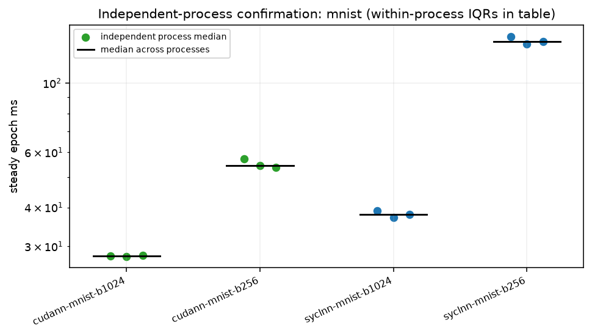
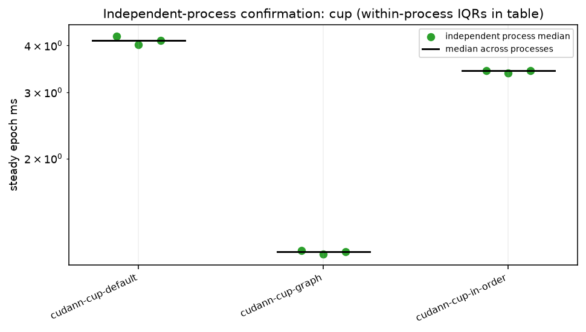

# Independent-process statistical confirmation

Three rounds, alternating CUDA/DPC++ order for each MNIST batch; CUP option order reverses in round 2. Each entry is one fresh `fnnbench run` process. Exact commands and original protocol source rows are in round-*/<configuration>/command.json. Epochs/repeats follow the pass: MNIST 3/3; CUP default 5/5, in-order and graph 5/3. Different conditions stay in separate rows.

Per-process median = median of steady_epochs_s (first epoch of every call excluded). Across-process spread is (max−min)/median. Within-process steady IQR is reported separately; these epochs are not independent process replicates.

| configuration | processes | medians ms | median ms | min–max ms | spread | within-process steady IQR ms | epochs / repeats |
|---|---|---|---|---|---|---|---|
| cudann-cup-default | 3 | 4.2435, 4.0235, 4.1342 | 4.1342 | 4.0235–4.2435 | 5.3% | 0.1876, 0.1583, 0.1798 | 5 / 5 |
| cudann-cup-graph | 3 | 1.1375, 1.1130, 1.1273 | 1.1273 | 1.1130–1.1375 | 2.2% | 0.3105, 0.0056, 0.0231 | 5 / 3 |
| cudann-cup-in-order | 3 | 3.4351, 3.3734, 3.4252 | 3.4252 | 3.3734–3.4351 | 1.8% | 0.0677, 0.1797, 0.1345 | 5 / 3 |
| cudann-mnist-b1024 | 3 | 27.9866, 27.7939, 28.0490 | 27.9866 | 27.7939–28.0490 | 0.9% | 0.2125, 0.3464, 0.2637 | 3 / 3 |
| cudann-mnist-b256 | 3 | 57.1435, 54.4844, 53.8216 | 54.4844 | 53.8216–57.1435 | 6.1% | 3.2584, 0.8942, 1.1575 | 3 / 3 |
| syclnn-mnist-b1024 | 3 | 39.0288, 37.1496, 38.0276 | 38.0276 | 37.1496–39.0288 | 4.9% | 4.7515, 0.3087, 0.1423 | 3 / 3 |
| syclnn-mnist-b256 | 3 | 141.1810, 133.2762, 135.8880 | 135.8880 | 133.2762–141.1810 | 5.8% | 14.5207, 0.9037, 1.1179 | 3 / 3 |

Remaining independent processes: {}

versions.txt:

```text
Python 3.12.3
Name: numpy
Version: 2.5.2
Summary: Fundamental package for array computing in Python
Home-page: https://numpy.org
Author: Travis E. Oliphant et al.
Author-email: 
License-Expression: BSD-3-Clause AND 0BSD AND MIT AND Zlib AND CC0-1.0
Location: /opt/venv/lib/python3.12/site-packages
Requires: 
Required-by: cudann, fnn-testkit, fnnbench

```

## Conditions and limits

ws-nvidia; kernel `7.2.11-200.fc44.x86_64`; CPU maximum not exposed by guest kHz; boost=None; binding `numactl --cpunodebind=1 --membind=1`; process nice=0; NUMA balancing=0. GPU clocks were observed, not changed; snapshots are in conditions.json and any runtime monitors.

other services were running on the host and in the VM, as in every ws-nvidia pass; their CPU and GPU use is not controlled. The GPU was not dedicated to the benchmark. Pascal GPU; other GPU work remains possible. Bench mode only changes the listed runtime settings. No comparisons with the historical pass assume identical conditions.

GPU clock snapshot at collection start (not a clock lock or a time average):

```text
{
  "command": [
    "nvidia-smi",
    "--query-gpu=name,driver_version,clocks.current.sm,clocks.current.memory,power.draw,temperature.gpu,utilization.gpu,utilization.memory",
    "--format=csv"
  ],
  "exit": 0,
  "stdout": "name, driver_version, clocks.current.sm [MHz], clocks.current.memory [MHz], power.draw [W], temperature.gpu, utilization.gpu [%], utilization.memory [%]\nNVIDIA GeForce GTX 1080 Ti, 580.196.07, 1569 MHz, 5005 MHz, 62.08 W, 53, 2 %, 1 %",
  "stderr": ""
}
```

commands.txt:

```text
bash scripts/ws-nvidia-extras.sh stat-confirm 2026-11-04

```

versions.txt:

```text
Python 3.12.3
Name: numpy
Version: 2.5.2
Summary: Fundamental package for array computing in Python
Home-page: https://numpy.org
Author: Travis E. Oliphant et al.
Author-email: 
License-Expression: BSD-3-Clause AND 0BSD AND MIT AND Zlib AND CC0-1.0
Location: /opt/venv/lib/python3.12/site-packages
Requires: 
Required-by: cudann, fnn-testkit, fnnbench

```

bench-mode-status.txt:

```text
the host 2026-11-04T02:14:33+01:00
cpufreq: driver=intel_cpufreq intel_pstate=passive no_turbo=1 min_perf_pct=92 max_perf_pct=100
  policies: 24 governor=performance min=3500000 max=3500000
  scaling_cur_freq kHz (cpu0..23): 3500050 3500257 3500173 3500066 3500117 3500300 3497211 3532415 3500276 3504632 3500296 3500301 3500293 3500230 3500101 3500397 3500262 3500228 3500585 3500327 3500236 3499930 3498219 3498355
cpuidle: driver=intel_idle governor=menu cpu_dma_latency=1us (tuned: my-latency-performance)
  idle states allowed by PM QoS: POLL C1
kernel.numa_balancing=0 ksm.run=0 ksm.pages_sharing=0 zone_reclaim_mode=0 swappiness=10 swap=0kB
THP enabled=madvise defrag=never
node0 2M hugepages total=0 free=0  node1 2M hugepages total=0 free=0
ZFS ARC c_max=90.0 GiB size=49.4 GiB
zfs_arc_max param=96636764160
the VM: running (booted)  hugepage guard: inactive
```

background-host.txt:

```text
other services were running on the host and in the VM, as in every ws-nvidia pass; their CPU and GPU use is not controlled.
The GPU was not dedicated to the benchmark.
```





## Recorded implementation versions

cudann 0.1.2 (nvcc 12.9.86, host GNU 13.3.0) and syclnn 0.2.2 (DPC++/Clang 22.1.0, oneMath source tag v0.9, exported CMake package version 0.5.0) both map cuBLAS 12.9.2.10. Full flags, effective options and mapped libraries remain in the run/driver JSON files. Timing rows and traced/profiled rows retain their own measurement boundaries.

The oneMath tag v0.9 declares `project(oneMath VERSION 0.5.0)`. The installed `oneMathConfigVersion.cmake` exports that package version, which `syclnn.build_info().onemath` records via `find_package(oneMath)`. The same package metadata is used by the DPC++ and AdaptiveCpp builds; this experiment used DPC++.
