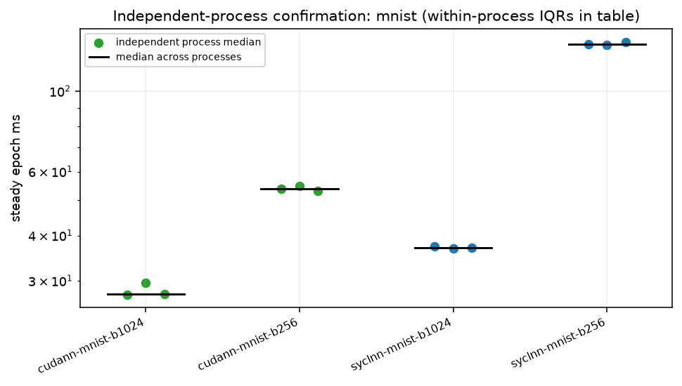
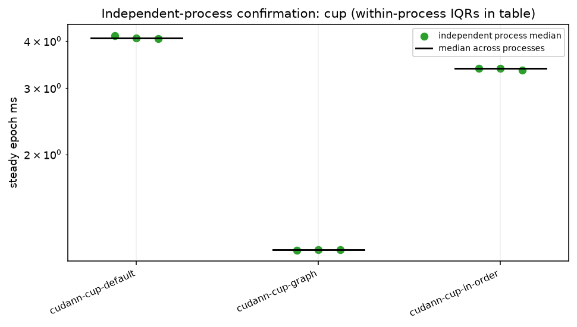

# Independent-process statistical confirmation

3 rounds, alternating CUDA/DPC++ order for each MNIST batch; CUP option order reverses in the even rounds. Each entry is one fresh `fnnbench run` process. Exact commands and original protocol source rows are in round-*/<configuration>/command.json. Epochs/repeats follow the pass: MNIST 3/3; CUP default 5/5, in-order and graph 5/3. Different conditions stay in separate rows.

Per-process median = median of steady_epochs_s (first epoch of every call excluded). Across-process spread is (max−min)/median. Within-process steady IQR is reported separately; these epochs are not independent process replicates.

| configuration | processes | medians ms | median ms | min–max ms | spread | within-process steady IQR ms | epochs / repeats |
|---|---|---|---|---|---|---|---|
| cudann-cup-default | 3 | 4.1422, 4.0768, 4.0674 | 4.0768 | 4.0674–4.1422 | 1.8% | 0.0609, 0.0536, 0.0993 | 5 / 5 |
| cudann-cup-graph | 3 | 1.1133, 1.1145, 1.1159 | 1.1145 | 1.1133–1.1159 | 0.2% | 0.0095, 0.0060, 0.0067 | 5 / 3 |
| cudann-cup-in-order | 3 | 3.3858, 3.3828, 3.3446 | 3.3828 | 3.3446–3.3858 | 1.2% | 0.0272, 0.0515, 0.0961 | 5 / 3 |
| cudann-mnist-b1024 | 3 | 27.4114, 29.5850, 27.5368 | 27.5368 | 27.4114–29.5850 | 7.9% | 0.0394, 2.5949, 0.0785 | 3 / 3 |
| cudann-mnist-b256 | 3 | 53.8578, 54.8659, 52.9985 | 53.8578 | 52.9985–54.8659 | 3.5% | 0.5724, 0.1516, 0.2780 | 3 / 3 |
| syclnn-mnist-b1024 | 3 | 37.4021, 36.8153, 36.9378 | 36.9378 | 36.8153–37.4021 | 1.6% | 0.3655, 0.2003, 0.2990 | 3 / 3 |
| syclnn-mnist-b256 | 3 | 134.4273, 134.3761, 136.8165 | 134.4273 | 134.3761–136.8165 | 1.8% | 0.1950, 0.1450, 0.3006 | 3 / 3 |

Remaining independent processes: {}

versions.txt:

```text
Python 3.12.3
Name: numpy
Version: 2.5.2
Summary: Fundamental package for array computing in Python
Home-page: https://numpy.org
Author: Travis E. Oliphant et al.
Author-email: 
License-Expression: BSD-3-Clause AND 0BSD AND MIT AND Zlib AND CC0-1.0
Location: /opt/venv/lib/python3.12/site-packages
Requires: 
Required-by: cudann, fnn-testkit, fnnbench

```

## Conditions and limits

ws-nvidia; kernel `7.2.11-200.fc44.x86_64`; CPU maximum not exposed by guest kHz; boost=None; binding `numactl --cpunodebind=1 --membind=1`; process nice=0; NUMA balancing=0. GPU policy and clock snapshots are in conditions.json and any runtime monitors. A profiling policy named in the binding was temporary and released after the run.

other services were running on the host and in the VM, as in every ws-nvidia pass; their CPU use is not controlled. Pascal GPU. Bench mode only changes the listed runtime settings. No comparisons with the historical pass assume identical conditions.

GPU clock snapshot at collection start (not a clock lock or a time average):

```text
{
  "command": [
    "nvidia-smi",
    "--query-gpu=name,driver_version,clocks.current.sm,clocks.current.memory,power.draw,temperature.gpu,utilization.gpu,utilization.memory",
    "--format=csv"
  ],
  "exit": 0,
  "stdout": "name, driver_version, clocks.current.sm [MHz], clocks.current.memory [MHz], power.draw [W], temperature.gpu, utilization.gpu [%], utilization.memory [%]\nNVIDIA GeForce GTX 1080 Ti, 580.196.07, 1733 MHz, 5508 MHz, 69.17 W, 54, 0 %, 0 %",
  "stderr": ""
}
```

No other process used the GPU during this run.

commands.txt:

```text
bash scripts/ws-nvidia-extras.sh stat-confirm 2026-11-06

```

versions.txt:

```text
Python 3.12.3
Name: numpy
Version: 2.5.2
Summary: Fundamental package for array computing in Python
Home-page: https://numpy.org
Author: Travis E. Oliphant et al.
Author-email: 
License-Expression: BSD-3-Clause AND 0BSD AND MIT AND Zlib AND CC0-1.0
Location: /opt/venv/lib/python3.12/site-packages
Requires: 
Required-by: cudann, fnn-testkit, fnnbench

```

background-host.txt:

```text
other services were running on the host and in the VM, as in every ws-nvidia pass; their CPU use is not controlled.
No other process used the GPU during this run.

```




