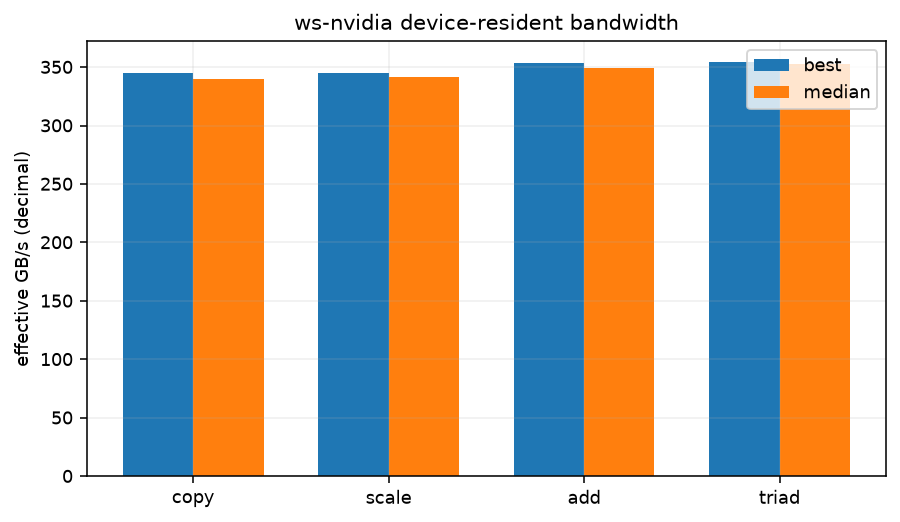

# Device-resident STREAM-style bandwidth

See commands.txt for the exact NUMA prefix and compiler invocation. Three 128 MiB float arrays, five warm-ups per operation, 31 repetitions timed by device events. GB/s is decimal and counts algorithmic read/write bytes; it is an effective bandwidth, not a DRAM counter. These are new workstation experiments, separate from the pass rows.

| operation | total array MiB | best ms | median ms | best GB/s | median GB/s |
|---|---|---|---|---|---|
| copy | 384 | 0.7782 | 0.7905 | 344.93 | 339.56 |
| scale | 384 | 0.7782 | 0.7854 | 344.93 | 341.78 |
| add | 384 | 1.1387 | 1.1520 | 353.61 | 349.53 |
| triad | 384 | 1.1366 | 1.1407 | 354.25 | 352.98 |

versions.txt:

```text
nvcc: NVIDIA (R) Cuda compiler driver
Copyright (c) 2005-2025 NVIDIA Corporation
Built on Tue_May_27_02:21:03_PDT_2025
Cuda compilation tools, release 12.9, V12.9.86
Build cuda_12.9.r12.9/compiler.36037853_0
Python 3.12.3

```

commands.txt:

```text
bash scripts/ws-nvidia-extras.sh stream 2026-11-04
nvcc -O3 -std=c++17 -arch=sm_61 -ccbin g++-13 scripts/stream-probe.cu -o stream-probe
./stream-probe (384 MiB, 31 repetitions)

```

## Conditions and limits

ws-nvidia; kernel `7.2.11-200.fc44.x86_64`; CPU maximum not exposed by guest kHz; boost=None; binding `numactl --cpunodebind=1 --membind=1`; process nice=0; NUMA balancing=0. GPU clocks were observed, not changed; snapshots are in conditions.json and any runtime monitors.

other services were running on the host and in the VM, as in every ws-nvidia pass; their CPU and GPU use is not controlled. The GPU was not dedicated to the benchmark. Pascal GPU; other GPU work remains possible. Bench mode only changes the listed runtime settings. No comparisons with the historical pass assume identical conditions.

GPU clock snapshot at collection start (not a clock lock or a time average):

```text
{
  "command": [
    "nvidia-smi",
    "--query-gpu=name,driver_version,clocks.current.sm,clocks.current.memory,power.draw,temperature.gpu,utilization.gpu,utilization.memory",
    "--format=csv"
  ],
  "exit": 0,
  "stdout": "name, driver_version, clocks.current.sm [MHz], clocks.current.memory [MHz], power.draw [W], temperature.gpu, utilization.gpu [%], utilization.memory [%]\nNVIDIA GeForce GTX 1080 Ti, 580.196.07, 1569 MHz, 5005 MHz, 60.99 W, 53, 2 %, 1 %",
  "stderr": ""
}
```

commands.txt:

```text
bash scripts/ws-nvidia-extras.sh stream 2026-11-04
nvcc -O3 -std=c++17 -arch=sm_61 -ccbin g++-13 scripts/stream-probe.cu -o stream-probe
./stream-probe (384 MiB, 31 repetitions)

```

versions.txt:

```text
nvcc: NVIDIA (R) Cuda compiler driver
Copyright (c) 2005-2025 NVIDIA Corporation
Built on Tue_May_27_02:21:03_PDT_2025
Cuda compilation tools, release 12.9, V12.9.86
Build cuda_12.9.r12.9/compiler.36037853_0
Python 3.12.3

```

bench-mode-status.txt:

```text
the host 2026-11-04T01:51:19+01:00
cpufreq: driver=intel_cpufreq intel_pstate=passive no_turbo=1 min_perf_pct=92 max_perf_pct=100
  policies: 24 governor=performance min=3500000 max=3500000
  scaling_cur_freq kHz (cpu0..23): 3500231 3500628 3500277 3500638 3500278 3501052 3500288 3499728 3500105 3500165 3500232 3500278 3500262 3501100 3500000 3500357 3500000 3500278 3499124 3500212 3499662 3500269 3500354 3501794
cpuidle: driver=intel_idle governor=menu cpu_dma_latency=1us (tuned: my-latency-performance)
  idle states allowed by PM QoS: POLL C1
kernel.numa_balancing=0 ksm.run=0 ksm.pages_sharing=0 zone_reclaim_mode=0 swappiness=10 swap=0kB
THP enabled=madvise defrag=never
node0 2M hugepages total=0 free=0  node1 2M hugepages total=0 free=0
ZFS ARC c_max=90.0 GiB size=50.6 GiB
zfs_arc_max param=96636764160
the VM: running (booted)  hugepage guard: inactive
```

background-host.txt:

```text
other services were running on the host and in the VM, as in every ws-nvidia pass; their CPU and GPU use is not controlled.
The GPU was not dedicated to the benchmark.
```


