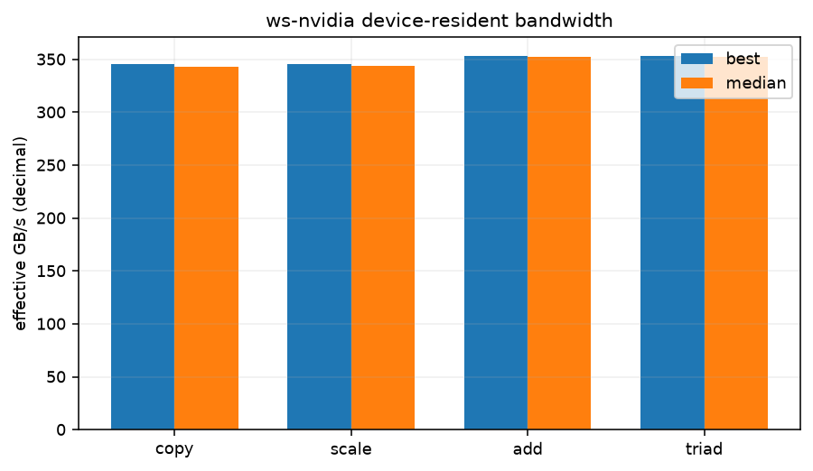

# Device-resident STREAM-style bandwidth

See commands.txt for the exact NUMA prefix and compiler invocation. Three device-resident float arrays (size in the table), five warm-ups per operation, and repeated device-event timings. GB/s is decimal and counts algorithmic read/write bytes; it is an effective bandwidth, not a DRAM counter. These are new workstation experiments, separate from the pass rows.

| operation | total array MiB | best ms | median ms | best GB/s | median GB/s |
|---|---|---|---|---|---|
| copy | 384 | 0.7769 | 0.7831 | 345.52 | 342.78 |
| scale | 384 | 0.7768 | 0.7811 | 345.55 | 343.67 |
| add | 384 | 1.1407 | 1.1437 | 352.98 | 352.05 |
| triad | 384 | 1.1404 | 1.1428 | 353.09 | 352.34 |

versions.txt:

```text
nvcc: NVIDIA (R) Cuda compiler driver
Copyright (c) 2005-2025 NVIDIA Corporation
Built on Tue_May_27_02:21:03_PDT_2025
Cuda compilation tools, release 12.9, V12.9.86
Build cuda_12.9.r12.9/compiler.36037853_0
Python 3.12.3

```

commands.txt:

```text
bash scripts/ws-nvidia-extras.sh stream 2026-11-06
nvcc -O3 -std=c++17 -arch=sm_61 -ccbin g++-13 scripts/stream-probe.cu -o stream-probe
./stream-probe (384 MiB, 31 repetitions)

```

## Conditions and limits

ws-nvidia; kernel `7.2.11-200.fc44.x86_64`; CPU maximum not exposed by guest kHz; boost=None; binding `numactl --cpunodebind=1 --membind=1`; process nice=0; NUMA balancing=0. GPU policy and clock snapshots are in conditions.json and any runtime monitors. A profiling policy named in the binding was temporary and released after the run.

other services were running on the host and in the VM, as in every ws-nvidia pass; their CPU use is not controlled. Pascal GPU. Bench mode only changes the listed runtime settings. No comparisons with the historical pass assume identical conditions.

GPU clock snapshot at collection start (not a clock lock or a time average):

```text
{
  "command": [
    "nvidia-smi",
    "--query-gpu=name,driver_version,clocks.current.sm,clocks.current.memory,power.draw,temperature.gpu,utilization.gpu,utilization.memory",
    "--format=csv"
  ],
  "exit": 0,
  "stdout": "name, driver_version, clocks.current.sm [MHz], clocks.current.memory [MHz], power.draw [W], temperature.gpu, utilization.gpu [%], utilization.memory [%]\nNVIDIA GeForce GTX 1080 Ti, 580.196.07, 734 MHz, 810 MHz, 15.04 W, 54, 0 %, 0 %",
  "stderr": ""
}
```

No other process used the GPU during this run.

commands.txt:

```text
bash scripts/ws-nvidia-extras.sh stream 2026-11-06
nvcc -O3 -std=c++17 -arch=sm_61 -ccbin g++-13 scripts/stream-probe.cu -o stream-probe
./stream-probe (384 MiB, 31 repetitions)

```

versions.txt:

```text
nvcc: NVIDIA (R) Cuda compiler driver
Copyright (c) 2005-2025 NVIDIA Corporation
Built on Tue_May_27_02:21:03_PDT_2025
Cuda compilation tools, release 12.9, V12.9.86
Build cuda_12.9.r12.9/compiler.36037853_0
Python 3.12.3

```

background-host.txt:

```text
other services were running on the host and in the VM, as in every ws-nvidia pass; their CPU use is not controlled.
No other process used the GPU during this run.

```


